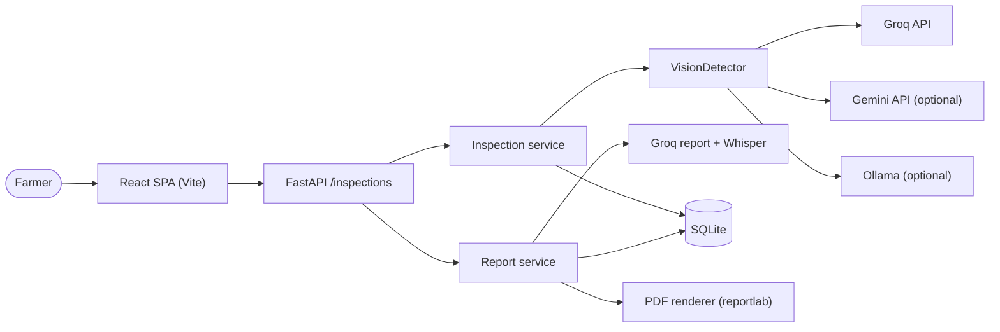
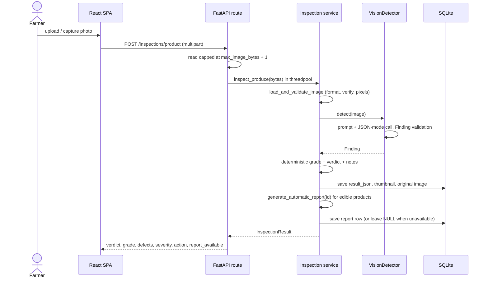
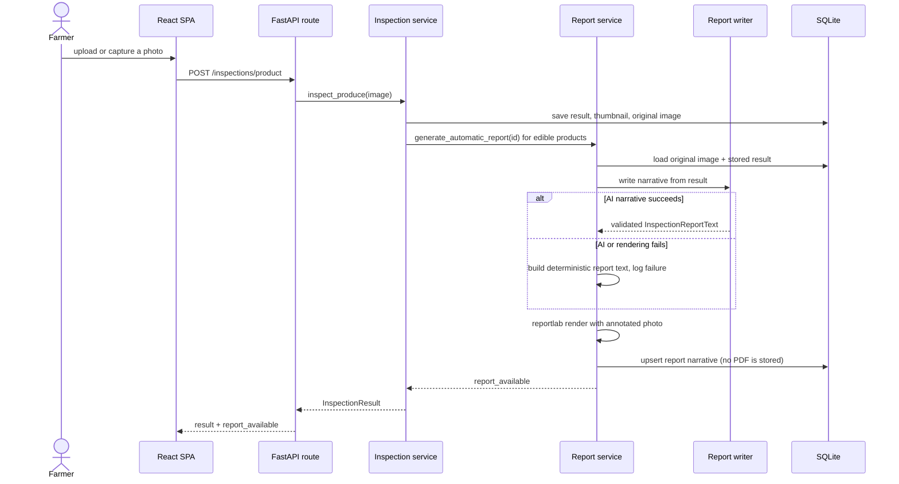
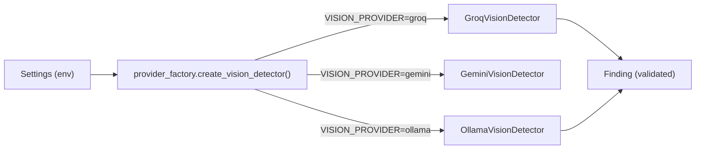

# Architecture — Fieldmark

Software-only product grading for farmers. A photo goes in, a validated AI finding and
deterministic grading rules come out as a verdict, quality grade, and recommended action, and an
AI-written PDF report is generated automatically for every edible product. This document describes
the system as it is implemented, not as it is planned; the README keeps the short version for
first-time readers.

## 1. Purpose and scope

**Goals.** Let a farmer upload or capture a product photo, receive a pass/defect verdict with a
confidence score and a plain-language explanation, keep a local inspection history, and download
a professional PDF report — generated automatically, with an optional voice note added afterwards.

**Non-goals (out of scope per the project SOW).** Hardware and sensors, user accounts,
multi-tenancy, payments, production deployment and scaling, and training models from scratch.
Inference uses a hosted API model (Groq or Google Gemini) with an optional local Ollama provider behind the same
interface.

**Chosen user type.** Farmer (product grading after harvest): bruises, rot, mold, and deformities
on photos of the configured inspection categories, with quality grades (A / B / Reject) and
sell-or-discard advice.

## 2. System context



The browser talks only to the FastAPI process, which in turn talks to exactly one configured
vision provider. Groq is the default; Gemini (free tier, structured JSON schemas) and Ollama are optional
exists for the optional local-model path and is never selected automatically.

## 3. Components

| Path | Responsibility |
|---|---|
| `app/api/routes_inspection.py` | HTTP boundary: multipart parsing, size/format guards, domain-to-HTTP error mapping, pagination limits |
| `app/api/routes_categories.py` | Category API: list, create, rename/enable/disable, delete |
| `app/services/inspection_service.py` | Image validation (PIL), active-category loading, deterministic grading rules, verdict notes, persistence |
| `app/services/category_service.py` | Category validation, slug generation, limits, and lifecycle rules |
| `app/services/report_service.py` | Orchestrates transcription, AI narrative, PDF rendering, and report persistence |
| `app/ai/provider_factory.py` | Builds the configured `VisionDetector` from settings (no network at construction) |
| `app/ai/produce_groq.py` | Groq vision provider: base64 image prompt, JSON-mode response, schema validation |
| `app/ai/produce_gemini.py` | Gemini provider: structured JSON schemas for analysis and defect localization |
| `app/ai/produce_ollama.py` | Local Ollama provider: stdlib HTTP client, response size cap, schema validation |
| `app/ai/groq_report.py` | Whisper transcription (report voice notes) and one-shot report writing with validated JSON output |
| `app/ai/gemini_transcribe.py` | Gemini 3.5 Transcribe for voice-note-only inspections |
| `app/ai/transcription.py` | Provider dispatcher for voice-note-only inspection transcription |
| `app/ai/schemas.py` | Pydantic contracts: `Finding`, `InspectionResult`, `InspectionReportText`, history models |
| `app/ai/prompts.py` | System/user prompts for the vision model, including injection-hardening rules |
| `app/reports/pdf_renderer.py` | One-page reportlab PDF: metadata, evidence photos, quick-scan card, narrative |
| `app/storage/inspection_repository.py` | Parameterized SQLite access, image/report paths, schema migration |
| `app/storage/category_repository.py` | Category persistence and default seeding in SQLite |
| `app/core/config.py` | Environment-driven `Settings` with URL validation |
| `frontend/src/services/api.ts` | Inspection API boundary: typed calls, `ApiError`, URL building |
| `frontend/src/services/categories.ts` | Category API calls and types |
| `frontend/src/App.tsx` | App shell, navigation, theme, API status, routes |
| `frontend/src/pages/InspectPage.tsx` | Upload/camera, result panel, report controls, history, clear |
| `frontend/src/pages/CategoriesPage.tsx` | Category list, add/rename/enable/disable/delete |

## 4. Data flow

### 4.1 Inspection



### 4.2 Automatic PDF report with fallback



Every edible product, including fruit outside the inspection categories, gets the same report
layout. Non-edible items get no PDF. When AI report writing fails, the deterministic narrative is
used instead; if that fallback also fails, no report row is stored and the interface shows the
report as unavailable.

The PDF itself is not stored. `GET /inspections/{id}/report` rebuilds it from the saved narrative,
result, and original photo on every download. Adding a voice note calls
`POST /inspections/{id}/report`, which replaces the stored narrative with a narrated version and
returns the rebuilt PDF as a download.


### 4.3 History and clearing

`GET /inspections/history` returns reverse-chronological summaries with `report_available` and
`report_source_available` flags. `DELETE /inspections/history` deletes database rows and removes
the `images/` and `reports/` directories. `GET .../thumbnail` streams the 192×192 JPEG preview.

## 5. Data model

Single SQLite file (default `data/inspections.sqlite3`), created and migrated lazily on first
connection. All queries are parameterized.

```sql
CREATE TABLE inspections (
    inspection_id       TEXT PRIMARY KEY,
    created_at          TEXT NOT NULL,    -- ISO-8601 UTC
    produce_type        TEXT NOT NULL,
    verdict             TEXT NOT NULL,    -- pass | defect | needs_review
    grade               TEXT NOT NULL,    -- A | B | Reject | Needs manual review
    thumbnail_path      TEXT,             -- relative to the data directory
    original_image_path TEXT,             -- relative to the data directory
    result_json         TEXT              -- serialized InspectionResult
);

CREATE TABLE product_categories (
    slug            TEXT PRIMARY KEY,    -- stable slug used by inspection results
    display_name    TEXT NOT NULL,
    emoji           TEXT NOT NULL DEFAULT '',
    is_active       INTEGER NOT NULL DEFAULT 1,
    created_at      TEXT NOT NULL
);

CREATE TABLE inspection_reports (
    inspection_id   TEXT PRIMARY KEY,    -- one report per inspection (upserted)
    report_id       TEXT NOT NULL UNIQUE,
    created_at      TEXT NOT NULL,
    user_type       TEXT NOT NULL,       -- farmer
    transcript      TEXT NOT NULL,       -- "" when no voice note
    report_text_json TEXT NOT NULL,      -- validated InspectionReportText
);
```

The original four categories are seeded once per database. Active category slugs are loaded for
every new inspection and passed to the vision prompt. Renaming changes only `display_name`; the
slug stays stable. Disabling sets `is_active = 0` and removes the category from future prompts.
Deletion is allowed only when no stored inspection references the slug; otherwise the API asks the
client to disable it instead. At least one category must remain active.

Images are files under the data directory: `data/images/{inspection_id}_original.bin`,
`data/images/{inspection_id}_thumbnail.jpg`, and
`data/images/{inspection_id}_annotated.jpg`. SQLite stores only metadata and relative paths; PDFs
are rebuilt on download and never stored, so the
database stays small and portable.

A legacy migration rebuilds databases that still have `thumbnail` and `original_image` BLOB
columns: existing BLOBs are written to `data/images/`, their paths are stored, and the BLOB columns
are removed. Legacy rows without a source photo are rejected for reporting with HTTP 409 rather
than fabricated.

**Retention rules.** Every successful inspection stores the full result and metadata in SQLite,
with the thumbnail and original photo on disk. Clearing history deletes the report and image
directories along with the database rows. Images are never stored as BLOBs in SQLite.

## 6. API surface

| Method | Path | Success | Client errors | Provider/server errors |
|---|---|---|---|---|
| POST | `/inspections/product` | 200 `InspectionResult` | 400 invalid image, 413 too large | 500 storage, 502 detection |
| POST | `/inspections/produce` (legacy alias) | 200 `InspectionResult` | same | same |
| POST | `/inspections/tomato` (legacy alias) | 200 `InspectionResult` | same | same |
| GET | `/inspections/history?limit&offset` | 200 page (limit 1–100, default 20) | 422 invalid query | 500 |
| DELETE | `/inspections/history` | 204 | — | 500 |
| GET | `/inspections/history/{id}/thumbnail` | 200 JPEG | 404 | 500 |
| POST | `/inspections/{id}/report` | 200 PDF attachment | 400 invalid audio / transcript too long, 413 audio too large, 409 no source photo | 500 storage/render, 502 AI |
| GET | `/inspections/{id}/report?download=true` | 200 PDF attachment | 404 | 500 |
| GET | `/api/categories` | 200 `{"items":[...]}` | — | 500 |
| POST | `/api/categories` | 201 category | 400 invalid/reserved name, 409 duplicate/limit | 500 |
| PATCH | `/api/categories/{slug}` | 200 category | 400 invalid/last active, 404 | 500 |
| DELETE | `/api/categories/{slug}` | 204 | 400 last active, 404, 409 in use | 500 |
| GET | `/health` | 200 `{"status":"ok"}` | — | — |

Route parameters are typed as `UUID`, so malformed identifiers are rejected by FastAPI before
reaching the service layer.

## 7. AI abstraction and model swap



- `VisionDetector` is a callable protocol (`__call__(image) -> Finding`) in `app/ai/providers.py`;
  both providers implement it and raise `DetectionError` on failure.
- **Groq** (`meta-llama/llama-4-scout-17b-16e-instruct` by default) receives a base64 JPEG with
  `response_format={"type": "json_object"}` and temperature 0 for determinism.
- **Gemini** sends an inline JPEG with `responseMimeType=application/json` and a `responseSchema`
  for both calls; `gemini-4-hydrogen` analyzes and `gemini-3.5-flash-lite` localizes the defect.
- **Ollama** posts to `{base_url}/api/chat` with `format=json`, a 120 s timeout, and a 64 KB
  response cap. It is opt-in (`VISION_PROVIDER=ollama`) and never a silent fallback.
- **Report path.** `GROQ_TRANSCRIPTION_MODEL` (Whisper) transcribes voice notes attached to reports;
  the report writer defaults to the vision model when `GROQ_REPORT_MODEL` is unset.
- **Voice-note-only inspection path.** `TRANSCRIPTION_PROVIDER` selects Gemini (default, via
  `client.files.upload` + `client.interactions.create` on `gemini-3.5-transcribe`, with the uploaded
  file deleted afterwards) or Groq Whisper. Its transcript is stored on the result without an image.
- **Validation.** Model output is never trusted: `Finding` bounds confidence to [0, 1], discards
  non-normalized or unordered bounding boxes, and caps `visual_observation` at 240 characters.
  `InspectionReportText` forbids extra fields and cross-checks the voice-note relation: a
  `conflicts` relation requires a non-empty explanation, and an explanation without a conflict is
  rejected.

## 8. Deterministic grading rules

All thresholds are constants in `inspection_service.py`; the model only reports observations.

| Condition | Result |
|---|---|
| Product is not an edible item | No quality grade; shown as an unsupported item |
| Edible product outside the categories (for example guava) | Normal fresh/rotten rules, flagged as outside the categories |
| Product type unknown, or model unsure | Needs manual review |
| Rotten, confidence ≥ 0.60 | Reject + separate/discard advice |
| Rotten, confidence < 0.60 | Needs manual review |
| Fresh, confidence < 0.40 | Needs manual review |
| Fresh, severity high, or mold reported | Needs manual review |
| Fresh, confidence ≥ 0.70, severity none | Grade A + premium advice |
| Everything else fresh | Grade B + standard advice |

Verdicts follow the grade: review → `needs_review`, Reject or any reported defect → `defect`,
otherwise `pass`. `verdict_notes` explain the decision without exposing thresholds or repeating
model-reported confidence percentages. The vision model reports `detected_item` and
`item_is_fruit`; the service sets `in_inspection_categories` so the interface can show a normal
result for any edible product and a plain "Unsupported item" result for everything else.

## 9. Error handling

| Layer | Failure | Handling |
|---|---|---|
| Route | Oversized image/voice note | Read capped at limit + 1 byte → 413 |
| Service | Bad image (format, verify, decompression bomb, OS) | `InvalidImageError` → 400, logged |
| Provider | Groq API error, invalid JSON, missing key | `DetectionError` → 502, logged |
| Provider | Gemini API/invalid structured JSON/missing key | `DetectionError` → 502, logged |
| Provider | Ollama network/timeout/oversize | `DetectionError` → 502 |
| Report AI | Model unavailable, rate-limited, invalid JSON, no response | Distinct actionable messages → 502 |
| Report AI | Contradiction between transcript and visual result | Required conflict explanation, validated |
| Service | Transcript longer than 800 characters | 400 with a clear message |
| Storage | Any `sqlite3.Error` / `OSError` | `HistoryStorageError` → 500, logged |
| PDF | Layout/render errors (`LayoutError`, `OSError`) | `InspectionReportError` → 500 |

Rules applied throughout: no bare excepts, no swallowed exceptions, `raise ... from exc` chaining,
module loggers (never `print`), exception *types* logged but never keys or personal data.

## 10. Security boundaries

- **Secrets** live only in environment variables / the local `.env`; `.env` is gitignored and
  excluded from the Docker build context. The Docker image contains no key material.
- **Input validation at the boundary.** Pydantic validates every model response; routes enforce
  file-type allowlists (JPEG/PNG/WEBP images; flac/m4a/mp3/mpga/ogg/wav/webm audio), size limits
  (10 MB image, 25 MB voice note), and a 25-megapixel decompression-bomb guard.
- **Prompt injection.** Voice-note transcripts are treated as untrusted data: the report prompt
  instructs the model to treat transcript text as observations, never instructions, and to
  describe both sources when they conflict instead of obeying the transcript.
- **LLM output as untrusted input.** Both the vision `Finding` and the report narrative are
  schema-validated before use; unexpected fields are rejected (`extra="forbid"`).
- **SQL injection.** All statements are parameterized; identifiers come from code, not input.
- **Path traversal.** No user-supplied path is ever opened: images and audio are processed in
  memory, database paths come from configuration, and route parameters are UUIDs.
- **No `eval` / `pickle`** on user data; JSON only.

## 11. Configuration

| Variable | Default | Purpose |
|---|---|---|
| `VISION_PROVIDER` | `groq` | `groq`, `ollama`, or `gemini` |
| `GROQ_API_KEY` | *(empty)* | Required for Groq vision, report writing, and transcription |
| `GROQ_VISION_MODEL` | `qwen/qwen3.8-27b` | Vision model |
| `GROQ_REPORT_MODEL` | `openai/gpt-oss-20b` | Report narrative model |
| `GROQ_TRANSCRIPTION_MODEL` | `whisper-large-v3-turbo` | Voice notes attached to PDF reports |
| `TRANSCRIPTION_PROVIDER` | `gemini` | `gemini` or `groq` for voice-note-only inspections |
| `GEMINI_TRANSCRIPTION_MODEL` | `gemini-3.5-transcribe` | Voice-note-only inspection transcription |
| `GEMINI_API_KEY` | *(empty)* | Required for the Gemini provider |
| `GEMINI_VISION_MODEL` | `gemini-4-hydrogen` | Analysis model |
| `GEMINI_LOCALIZATION_MODEL` | `gemini-3.5-flash-lite` | Second-stage defect box model |
| `GEMINI_FALLBACK_MODELS` | `gemini-3.8-flash,gemini-3.6-flash,gemini-3.5-flash-lite` | Tried on transient model errors |
| `OLLAMA_BASE_URL` | `http://localhost:11434` | Validated absolute HTTP(S) URL |
| `OLLAMA_VISION_MODEL` | `qwen2.5vl:7b` | Local vision model |
| `INSPECTION_DB_PATH` | `data/inspections.sqlite3` | Absolute in Docker (`/app/data/...`) |
| `FRONTEND_ORIGIN` | `http://localhost:3000` | Allowed CORS origin for the separate frontend |
| `VITE_API_BASE_URL` | `http://localhost:8000` | API URL baked into the frontend at build time |
| `WEB_PORT` | `3000` | Host port for the frontend container |

## 12. Deployment

Two containers, two origins. The backend image installs locked Python dependencies with `uv` and
runs Uvicorn as non-root user `inspector` (uid 10001); it serves only API routes and `/health`. The
frontend image builds the Vite bundle with Node and serves it with `vite preview`, including SPA
fallback for routes such as `/categories`. CORS middleware in FastAPI allows the frontend origin
(`FRONTEND_ORIGIN`, default `http://localhost:3000`).

- Docker Compose publishes `8000:8000` for the backend and `${WEB_PORT:-3000}:3000` for the
  frontend, injects `.env` at runtime, and bind-mounts the host `./data/` directory at `/app/data`
  on the backend, so inspection history survives restarts, rebuilds, and `docker compose down`.
  Deleting the host `./data/` directory removes that data.
- `VITE_API_BASE_URL` is baked into the frontend bundle at build time; rebuild the frontend image
  after changing it. The built-in Vite dev proxy keeps local `npm run dev` working unchanged.
- A `HEALTHCHECK` polls `/health` from inside the backend container.
- SQLite requires a single instance; do not scale to replicas or run on multi-node hosts.

## 13. Testing

`uv run pytest --cov=app --cov-report=term-missing` — 112 tests, 87% line coverage.

- `tests/test_api.py` — route behavior, status-code mapping, pagination, oversized/invalid
  uploads, report routes, an end-to-end happy path through the API with a mocked detector.
- `tests/test_inspection.py` — grading rules, verdict notes, invalid images.
- `tests/test_providers.py` — factory selection, key handling, provider request/response
  handling, network failure translation.
- `tests/test_reports.py` — transcription, narrative validation, conflict handling, annotated
  photo rendering, one-page layout constraints, actionable AI error mapping.
- `tests/test_categories.py` — category seeding, create/rename/disable/delete rules, and dynamic
  categories in new inspections.
- `tests/test_config.py` — settings defaults and Ollama URL validation.

The AI model is always mocked (`monkeypatch`) in unit tests, so the suite is deterministic and
network-free; no test calls a live provider.

## 14. Limitations and known gaps

- The bounding box is returned by the API, drawn by the backend into a saved annotated JPEG, and
  rendered in the PDF. The result panel shows that image when coordinates are available, but does
  not yet display the confidence score.
- No audio-duration limit is enforced (size and post-transcription length are).
- The Gemini and Ollama providers are implemented and unit-tested but have no documented live run or
  performance numbers; the local-model bonus (quantization/batching metrics) is not done.
- The optional multi-inspection summary report from the SOW is not implemented.
- SQLite limits the system to one writer process; concurrent-heavy or multi-node deployments
  would need a different store (explicitly out of scope for the MVP).
