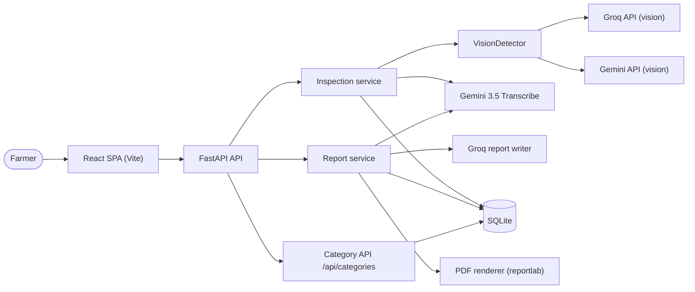
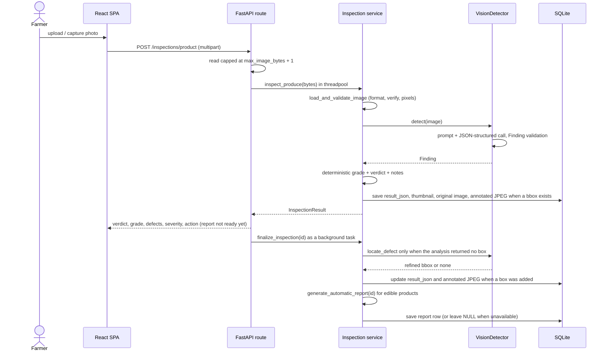
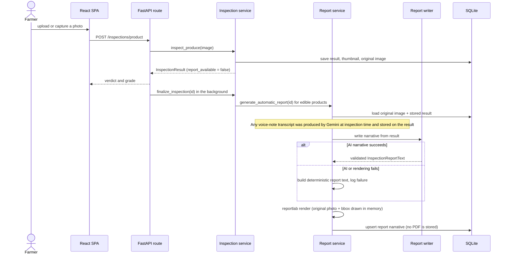
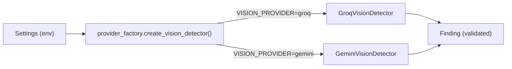

# Architecture — Visual Defect Inspector

Software-only product grading for farmers. A photo goes in, a validated AI finding and
deterministic grading rules come out as a verdict, quality grade, and recommended action, and an
AI-written PDF report is generated automatically for every edible product. This document describes
the system as it is implemented, not as it is planned; the README keeps the short version for
first-time readers.

## 1. Purpose and scope

**Goals.** Let a farmer upload or capture a product photo, receive a pass/defect verdict with a
confidence score and a plain-language explanation, keep a local inspection history, and download
a professional PDF report — generated automatically, with optional voice-note context captured at
inspection time.

**Non-goals (out of scope per the project SOW).** Hardware and sensors, user accounts,
multi-tenancy, payments, production deployment and scaling, and training models from scratch.
Inference uses a hosted API model (Groq or Google Gemini) behind a swappable provider interface.

**Chosen user type.** Farmer (product grading after harvest): bruises, rot, mold, and deformities
on photos of the configured inspection categories, with quality grades (A / B / Reject) and
sell-or-discard advice.

## 2. Technology stack

### 2.1 Backend

- **Python 3.12+**, managed with `uv` (`pyproject.toml`, `uv.lock`); no pip.
- **FastAPI** is the HTTP framework. `app/main.py` creates the app, installs CORS middleware for
  `FRONTEND_ORIGIN`, and mounts two `APIRouter`s. Routes declare typed `Annotated` parameters
  (`File()`, `Form()`, `Query()`), use `UUID` path parameters and `response_model` for responses,
  and map domain errors to `HTTPException` status codes. Blocking work — image validation, SQLite,
  and AI calls — is offloaded with `run_in_threadpool` so the event loop stays responsive. An upload
response waits only for validation and the first vision call; defect refinement and PDF report
generation are deferred to FastAPI `BackgroundTasks` so the verdict is not held up by further
hosted-model round trips.
- **Pydantic v2** validates every model response and API payload in `app/ai/schemas.py`
  (`extra="forbid"`, value bounds, enums). **pydantic-settings** `BaseSettings` in
  `app/core/config.py` loads typed settings from the environment and `.env`, with API keys held as
  `SecretStr`.
- **AI clients**: the `groq` SDK (vision and report writing) and the `google-genai` SDK (vision and
  Gemini 3.5 Transcribe), both behind the `VisionDetector` callable protocol in
  `app/ai/providers.py`.
- **Pillow** validates and decodes uploads, writes thumbnails, and draws bounding boxes on annotated
  photos. **ReportLab** builds the one-page PDF with `SimpleDocTemplate`, platypus `Flowable`s, and
  direct `Canvas` drawing (`app/reports/pdf_renderer.py`).
- **PyYAML** loads the allowed-fruit list in `app/services/category_service.py`;
  **python-multipart** enables multipart upload parsing.
- **Uvicorn** serves the ASGI app (`uv run uvicorn app.main:app --reload` locally; the container runs
  it as a non-root user).
- **Quality tooling**: ruff (lint and format), pyright (types), pytest + pytest-cov, and httpx for
  API tests.

### 2.2 Frontend

- **TypeScript and React 19** with strict compiler options (`noUnusedLocals`, `noUnusedParameters`),
  so unused imports and variables fail the build.
- **Vite 8** with `@vitejs/plugin-react` builds the bundle (`tsc -b && vite build`). In development
  the Vite server proxies `/health`, `/inspections`, and `/api` to `http://127.0.0.1:8000`; in Docker
  the built bundle is served with `vite preview`.
- **React Router v7** provides the two client-side routes: `main.tsx` installs `BrowserRouter` and
  `App.tsx` maps `/` to `InspectPage` and `/categories` to `CategoriesPage`. SPA fallback for a
  direct `/categories` refresh comes from the Vite dev server or the `vite preview` container; the
  FastAPI process serves only API routes and `/health`.
- **lucide-react** supplies icons; styling is plain CSS (`index.css`, `App.css`) — no CSS framework.
- **API layer**: every backend call goes through `frontend/src/services/api.ts` (inspections,
  reports, history, health) and `frontend/src/services/categories.ts`, using typed response models,
  a shared `ApiError`, a base-URL helper driven by `VITE_API_BASE_URL`, and a 90-second
  `AbortController` timeout for inspection requests.
- **Quality tooling**: ESLint + oxlint for linting, Prettier for formatting, and the TypeScript
  compiler as a build gate.

### 2.3 Database and file storage

- **SQLite** through Python's standard `sqlite3` module. One database file,
  `data/inspections.sqlite3` by default (`INSPECTION_DB_PATH` overrides it), with three tables:
  `inspections`, `product_categories`, and `inspection_reports` (see §7). All queries are
  parameterized; the schema is created and migrated lazily on the first connection.
- **Filesystem storage**: original photos, thumbnails, and annotated JPEGs live in `data/images/`;
  SQLite stores only relative paths. PDF files are never persisted — each report is rebuilt from
  its stored narrative and evidence image at download time.
- **Deployment**: Docker Compose bind-mounts host `./data` at `/app/data`, so history survives
  container restarts and rebuilds. SQLite is intentionally single-instance (see §16).

### 2.4 Framework implementation map

| Framework / library | Role | How it is used here |
|---|---|---|
| FastAPI + Uvicorn | HTTP API and ASGI server | Two `APIRouter`s, typed request/response models, `HTTPException` mapping, threadpool offload |
| Pydantic / pydantic-settings | Contracts and configuration | LLM output validation, `SecretStr` keys, environment-driven `Settings` |
| Groq / google-genai SDKs | Hosted AI providers | Swappable `VisionDetector` implementations, report writer, Gemini transcription |
| Pillow | Image processing | Format/verify/decompression-bomb checks, thumbnails, bounding-box annotation |
| ReportLab | PDF rendering | One-page A4 report with custom `Flowable`s and `Canvas` drawing |
| PyYAML | Category allowlist | Loads `fruits.yaml` for category validation |
| sqlite3 | Persistence | Parameterized queries and lazy schema migration |
| React + React Router | Web UI | Two pages, client-side routing, loading/empty/error states |
| Vite | Build and dev proxy | Bundles TypeScript and proxies API calls during development |
| pytest / ruff / pyright | Backend quality gates | Deterministic mocked tests, lint/format, static typing |
| ESLint / oxlint / Prettier | Frontend quality gates | Linting and formatting checks |
| Docker Compose | Local deployment | Two containers, runtime `.env`, persistent `./data` volume |

## 3. Feature list

### 3.1 Inspection

- **Photo input**: upload an image or capture one with the device camera in the browser
  (`InspectPage.tsx`, `POST /inspections/product`).
- **Voice input**: record a voice note in the browser or upload an audio file; Gemini 3.5 Transcribe
  produces the transcript. Voice-only inspections use the same endpoint without a photo.
- **AI finding**: the configured vision provider returns a schema-validated `Finding` with the
  detected product, edibility, condition, confidence, defect types, severity, visual observation,
  and bounding box.
- **Verdict and grade**: deterministic rules produce `pass` / `defect` / `needs_review`, a quality
  grade (A / B / Reject / Needs manual review), plain-language verdict notes, and a recommended next
  action suited to a farmer (sell, discard, or re-inspect). The confidence score is returned by the
  API and drawn in the PDF; the web result panel does not yet display it (see §16).
- **Defect location**: the analysis bounding box, optionally refined by a second-stage localization
  call, is drawn into a saved annotated JPEG and shown in the PDF.
- **Outside-category products**: edible products outside the active categories are graded normally
  and flagged as out of category; non-edible items are shown as unsupported with no grade.
- **PDF report**: every edible product gets an automatically generated AI narrative with a
  deterministic fallback. The one-page PDF includes the report ID, date, user type, original and
  annotated photos, verdict, confidence, defect types, severity, findings, and next steps, and is
  rebuilt on download. A voice note's transcript and context are folded into the narrative; a
  contradiction between audio and photo is called out instead of being silently resolved.

### 3.2 History and categories

- **Inspection history**: a reverse-chronological, paginated list with thumbnail, date, produce
  type, verdict, grade, transcript, and report availability, plus thumbnail/original/annotated
  image endpoints and a clear-history action that removes rows and images.
- **Inspection review**: clicking a history entry opens a read-only overlay that replays everything
  in the PDF — full result (grade, verdict, confidence, defects, severity, notes, action), original
  and annotated photos, transcript, and the stored written report narrative — so a past inspection
  can be reviewed without re-downloading the PDF. The overlay also keeps the PDF download action.
- **Category management**: list, create, rename, enable, disable, and delete products with an
  optional emoji; four seeded defaults; guards that keep at least one category active and prevent
  deleting a category referenced by saved inspections.
- **Defect relocation**: an API action to re-locate the defect on older inspections that have no
  stored bounding box.

### 3.3 Platform

- **Swappable vision provider** selected with `VISION_PROVIDER` (Groq or Gemini) behind one interface.
- **Environment-driven configuration** with a committed `.env.example`, `SecretStr` key handling,
  and input size/format limits.
- **Single-command Docker deployment** with a backend healthcheck and a persistent history volume.
- **Interactive API docs** at `/docs` and a `/health` endpoint.
- **Automated checks**: 148 tests with mocked AI clients, a coverage report, and lint/format/type
  gates (see §15).

## 4. System context



The browser talks only to the FastAPI process, which also serves the category API and `/health`.
Groq is the default vision provider and Gemini (free tier, structured JSON schemas) is the optional
alternative; the application never silently switches providers. Voice-note transcription always
uses Gemini 3.5 Transcribe, regardless of the selected vision provider.

## 5. Components

| Path | Responsibility |
|---|---|
| `app/api/routes_inspection.py` | HTTP boundary: multipart parsing, size/format guards, domain-to-HTTP error mapping, pagination limits |
| `app/api/routes_categories.py` | Category API: list, create, rename/enable/disable, delete |
| `app/services/inspection_service.py` | Image validation (PIL), active-category loading, deterministic grading rules, verdict notes, persistence |
| `app/services/job_service.py` | In-memory job registry, upload storage, and the background worker that runs analysis and reporting |
| `app/services/category_service.py` | Category validation, slug generation, limits, and lifecycle rules |
| `app/services/report_service.py` | Orchestrates transcription, AI narrative, PDF rendering, and report persistence |
| `app/ai/provider_factory.py` | Builds the configured `VisionDetector` from settings (no network at construction) |
| `app/ai/client_factory.py` | Caches one Groq/Gemini SDK client per credential with bounded request timeouts |
| `app/ai/produce_groq.py` | Groq vision provider: base64 image prompt, JSON-mode response, schema validation |
| `app/ai/produce_gemini.py` | Gemini provider: structured JSON schemas for analysis and defect localization |
| `app/ai/groq_report.py` | One-shot report writing with validated JSON output |
| `app/ai/gemini_transcribe.py` | Gemini 3.5 Transcribe for all voice notes (inspections and PDF reports) |
| `app/ai/transcription.py` | Single transcription entry point (Gemini) used by voice-only inspections |
| `app/ai/errors.py` | Shared `ReportAIError` for transcription and report-writing failures |
| `app/ai/schemas.py` | Pydantic contracts: `Finding`, `InspectionResult`, `InspectionReportText`, history and job models |
| `app/ai/prompt_config.py` | Loads, validates, caches, and substitutes the YAML prompt templates |
| `app/ai/prompt_templates/*.yaml` | Editable prompt text: inspection, localization, report, and voice analysis |
| `app/ai/prompts.py` | Stable facade exposing the loaded vision prompts to providers |
| `app/reports/pdf_renderer.py` | One-page reportlab PDF: metadata, evidence photos, quick-scan card, narrative |
| `app/storage/inspection_repository.py` | Parameterized SQLite access, image/report paths, schema migration |
| `app/storage/category_repository.py` | Category persistence and default seeding in SQLite |
| `app/core/config.py` | Environment-driven `Settings` for providers, models, limits, and storage paths |
| `frontend/src/services/api.ts` | Inspection API boundary: typed calls, `ApiError`, URL building |
| `frontend/src/services/categories.ts` | Category API calls and types |
| `frontend/src/context/InspectionJobsContext.tsx` | Provider above the router: submits jobs, polls status, toasts, last completed result |
| `frontend/src/context/useInspectionJobs.ts` | Hook used by pages to read the job manager |
| `frontend/src/App.tsx` | App shell, navigation, theme, API status, routes, global progress indicator and toasts |
| `frontend/src/pages/InspectPage.tsx` | Upload/camera, result panel, report download, history, clear, review launcher |
| `frontend/src/components/ReviewDrawer.tsx` | Read-only review overlay: full result, evidence photos, transcript, and report narrative |
| `frontend/src/pages/CategoriesPage.tsx` | Category list, add/rename/enable/disable/delete |

## 6. Data flow

### 6.1 Inspection



### 6.2 Automatic PDF report with fallback



For both photo and voice inspections the report portion of this flow runs after the response has
been sent, so a freshly returned result has `report_available=false` until the report row is saved.
The web UI polls history briefly to reveal the download button once the report is ready. Voice
transcription and transcript analysis stay on the response path because the transcript is the
evidence behind the verdict.

Every edible product, including fruit outside the inspection categories, gets the same report
layout. Non-edible items get no PDF. When AI report writing fails, the deterministic narrative is
used instead; if that fallback also fails, no report row is stored and the interface shows the
report as unavailable. When a voice note is present, Gemini 3.5 Transcribe produces the transcript
that is folded into the narrative; the report writer treats that text as untrusted evidence.

The PDF itself is not stored. `GET /inspections/{id}/report` rebuilds it from the saved narrative,
result, and original photo on every download. The API also accepts `POST /inspections/{id}/report`
with a voice note: Gemini transcribes it, the stored narrative is replaced with a narrated version,
and the rebuilt PDF is returned as a download. The web UI does not expose this update action.


### 6.3 History and clearing

`GET /inspections/history` returns reverse-chronological summaries with `report_available` and
`report_source_available` flags. `GET /inspections/history/{id}` returns the full stored
`InspectionResult` plus the optional report narrative for the review overlay; a corrupt report
narrative is treated as unavailable rather than failing the whole response.
`DELETE /inspections/history` deletes database rows and removes the `images/` and `reports/`
directories. `GET .../thumbnail` streams the 192×192 JPEG preview.

### 6.4 Background inspection jobs

The React app uses `POST /inspections/jobs` rather than the synchronous inspection endpoint. The
route validates the upload, writes the raw bytes under `data/uploads/`, creates an in-memory job,
and returns **202** with a job ID immediately. `process_job()` then runs in a FastAPI background
task: it reads the upload, calls `inspect_produce()` or `inspect_from_voice()` with the job's
`inspection_id`, and publishes the verdict immediately by marking the job `completed` with stage
`report`. Localization and report generation then continue in `_finish_report()`; a reporting
failure cannot turn an already delivered verdict into a failed job. Each stage logs its duration
(validation, vision, persistence, report writing, PDF rendering) so slow hosted calls can be
identified from the logs. At most two jobs run concurrently; failures are recorded on the job
rather than propagated to the client.

`GET /inspections/jobs` and `GET /inspections/jobs/{id}` expose job state to any page. The job
manager in `InspectionJobsProvider` lives above React Router, so switching from Inspect to
Categories does not cancel or forget a job: the top bar keeps a staged progress bar
(`validating` → `analyzing` → `report` → `done`) with a stage label, a toast announces the verdict,
and returning to Inspect reopens it. While the report is still being written the verdict is already
visible with a "Preparing PDF…" note, and the progress bar continues until `report_ready` is set.
The result panel is session-only: a browser refresh clears it, and a stale result is never shown
while another job is analyzing. Jobs are in-memory and therefore lost on
server restart; startup clears orphaned upload files. The older synchronous endpoints remain
available for API consumers.

## 7. Data model

Single SQLite file (default `data/inspections.sqlite3`), created and migrated lazily on first
connection. All queries are parameterized.

```sql
CREATE TABLE inspections (
    inspection_id       TEXT PRIMARY KEY,
    created_at          TEXT NOT NULL,    -- ISO-8601 UTC
    produce_type        TEXT NOT NULL,    -- matched category slug, or "unknown"
    detected_item       TEXT NOT NULL DEFAULT '',  -- real product name (e.g. grapes)
    verdict             TEXT NOT NULL,    -- pass | defect | needs_review
    grade               TEXT NOT NULL,    -- A | B | Reject | Needs manual review
    thumbnail_path      TEXT,             -- relative to the data directory
    original_image_path TEXT,             -- relative to the data directory
    result_json         TEXT              -- serialized InspectionResult
);

CREATE TABLE product_categories (
    slug            TEXT PRIMARY KEY,    -- stable slug used by inspection results
    display_name    TEXT NOT NULL,
    emoji           TEXT NOT NULL DEFAULT '',
    is_active       INTEGER NOT NULL DEFAULT 1,
    created_at      TEXT NOT NULL
);

CREATE TABLE inspection_reports (
    inspection_id   TEXT PRIMARY KEY,    -- one report per inspection (upserted)
    report_id       TEXT NOT NULL UNIQUE,
    created_at      TEXT NOT NULL,
    user_type       TEXT NOT NULL,       -- farmer
    transcript      TEXT NOT NULL,       -- "" when no voice note
    report_text_json TEXT NOT NULL,      -- validated InspectionReportText
);
```

`produce_type` records which configured category matched (`"unknown"` for anything outside the
active categories), while `detected_item` keeps the actual product name such as "grapes". Both are
stored as columns; older databases gain `detected_item` on first use, backfilled from `result_json`.
The UI, PDF, and history API show `detected_item`.

The original four categories are seeded once per database. Active category slugs are loaded for
every new inspection and passed to the vision prompt. Renaming changes only `display_name`; the
slug stays stable. Disabling sets `is_active = 0` and removes the category from future prompts.
Deletion is allowed only when no stored inspection references the slug; otherwise the API asks the
client to disable it instead. At least one category must remain active.

Images are files under the data directory: `data/images/{inspection_id}_original.bin`,
`data/images/{inspection_id}_thumbnail.jpg`, and
`data/images/{inspection_id}_annotated.jpg`. SQLite stores only metadata and relative paths; PDFs
are rebuilt on download and never stored, so the
database stays small and portable.

A legacy migration rebuilds databases that still have `thumbnail` and `original_image` BLOB
columns: existing BLOBs are written to `data/images/`, their paths are stored, and the BLOB columns
are removed. Legacy rows without a source photo are rejected for reporting with HTTP 409 rather
than fabricated.

**Retention rules.** Every successful inspection stores the full result and metadata in SQLite,
with the thumbnail and original photo on disk. Clearing history deletes the report and image
directories along with the database rows. Images are never stored as BLOBs in SQLite.

## 8. API surface

| Method | Path | Success | Client errors | Provider/server errors |
|---|---|---|---|---|
| POST | `/inspections/product` | 200 `InspectionResult` | 400 invalid image, 413 too large | 500 storage, 502 detection |
| POST | `/inspections/produce` (legacy alias) | 200 `InspectionResult` | same | same |
| POST | `/inspections/tomato` (legacy alias) | 200 `InspectionResult` | same | same |
| POST | `/inspections/jobs` | 202 `InspectionJob` (job ID) | 400 neither/both files, 413 too large | 500 storage |
| GET | `/inspections/jobs` | 200 list of recent jobs | — | — |
| GET | `/inspections/jobs/{id}` | 200 `InspectionJob` | 404 | — |
| GET | `/inspections/history?limit&offset` | 200 page (limit 1–100, default 20) | 422 invalid query | 500 |
| GET | `/inspections/history/{id}` | 200 `InspectionDetail` (result + optional report) | 404 | 500 |
| DELETE | `/inspections/history` | 204 | — | 500 |
| GET | `/inspections/history/{id}/thumbnail` | 200 JPEG | 404 | 500 |
| POST | `/inspections/{id}/report` | 200 PDF attachment | 400 invalid audio / transcript too long, 413 audio too large, 409 no source photo | 500 storage/render, 502 AI |
| GET | `/inspections/{id}/report?download=true` | 200 PDF attachment | 404 | 500 |
| GET | `/api/categories` | 200 `{"items":[...]}` | — | 500 |
| POST | `/api/categories` | 201 category | 400 invalid/reserved name, 409 duplicate/limit | 500 |
| PATCH | `/api/categories/{slug}` | 200 category | 400 invalid/last active, 404 | 500 |
| DELETE | `/api/categories/{slug}` | 204 | 400 last active, 404, 409 in use | 500 |
| GET | `/health` | 200 `{"status":"ok"}` | — | — |

Route parameters are typed as `UUID`, so malformed identifiers are rejected by FastAPI before
reaching the service layer.

## 9. AI abstraction and model swap



- `VisionDetector` is a callable protocol (`__call__(image) -> Finding`) in `app/ai/providers.py`;
  both providers implement it and raise `DetectionError` on failure.
- **Editable prompts.** Prompt text lives in four YAML files under `app/ai/prompt_templates/`
  (inspection, localization, report, voice analysis). `app/ai/prompt_config.py` validates each file
  against a Pydantic schema, substitutes `${placeholders}` such as the active category list, caches
  the result, and fails fast on missing or malformed configuration. The default directory is bundled
  in the image; `PROMPT_TEMPLATES_DIR` can point to a mounted folder to edit prompts without a
  rebuild. `app/ai/prompts.py` keeps the original public API for providers and tests.
- **Client reuse and latency bounds.** `app/ai/client_factory.py` caches one Groq/Gemini SDK client
  per credential with a bounded request timeout (`GROQ_TIMEOUT_SECONDS`, `GEMINI_TIMEOUT_MS`) so a
  stalled provider cannot hold a worker thread indefinitely and no request pays for a new TLS
  handshake. Gemini transient retries are capped by `GEMINI_MAX_FALLBACKS` with a short backoff.
- **Groq** (`qwen/qwen3.8-27b` by default) receives a base64 JPEG with
  `response_format={"type": "json_object"}` and temperature 0 for determinism.
- **Gemini** sends an inline JPEG with `responseMimeType=application/json` and a `responseSchema`
  for both calls; `gemini-4-hydrogen` analyzes and `gemini-3.5-flash-lite` localizes the defect.
- **Report path.** The report writer uses `GROQ_REPORT_MODEL` (default `openai/gpt-oss-20b`).
  Voice notes attached to reports are transcribed by the same Gemini path used for inspections.
- **Transcription path.** All voice notes use `GEMINI_TRANSCRIPTION_MODEL`
  (`gemini-3.5-transcribe` by default) via `client.files.upload` + `client.interactions.create`;
  the uploaded file is deleted afterwards. There is no provider switch and no Groq Whisper fallback.
  The transcript is stored on the result and passed to the report writer as untrusted evidence.
- **Validation.** Model output is never trusted: `Finding` bounds confidence to [0, 1], discards
  non-normalized or unordered bounding boxes, and caps `visual_observation` at 240 characters.
  `InspectionReportText` forbids extra fields and cross-checks the voice-note relation: a
  `conflicts` relation requires a non-empty explanation, and an explanation without a conflict is
  rejected.

## 10. Deterministic grading rules

All thresholds are constants in `inspection_service.py`; the model only reports observations.

| Condition | Result |
|---|---|
| Product is not an edible item | No quality grade; shown as an unsupported item |
| Edible product outside the categories (for example guava) | Normal fresh/rotten rules, flagged as outside the categories |
| Product type unknown, or model unsure | Needs manual review |
| Rotten, confidence ≥ 0.60 | Reject + separate/discard advice |
| Rotten, confidence < 0.60 | Needs manual review |
| Fresh, confidence < 0.40 | Needs manual review |
| Fresh, severity high, or mold reported | Needs manual review |
| Fresh, confidence ≥ 0.70, severity none | Grade A + premium advice |
| Everything else fresh | Grade B + standard advice |

Verdicts follow the grade: review → `needs_review`, Reject or any reported defect → `defect`,
otherwise `pass`. `verdict_notes` explain the decision without exposing thresholds or repeating
model-reported confidence percentages. The vision model reports `detected_item` and
`item_is_fruit`; the service sets `in_inspection_categories` so the interface can show a normal
result for any edible product and a plain "Unsupported item" result for everything else.

## 11. Error handling

| Layer | Failure | Handling |
|---|---|---|
| Route | Oversized image/voice note | Read capped at limit + 1 byte → 413 |
| Service | Bad image (format, verify, decompression bomb, OS) | `InvalidImageError` → 400, logged |
| Provider | Groq API error, invalid JSON, missing key | `DetectionError` → 502, logged |
| Provider | Gemini API/invalid structured JSON/missing key | `DetectionError` → 502, logged |
| Transcription | Gemini API error, missing key, empty/silent audio | `ReportAIError` with an actionable message |
| Report AI | Model unavailable, rate-limited, invalid JSON, no response | Distinct actionable messages → 502 |
| Report AI | Contradiction between transcript and visual result | Required conflict explanation, validated |
| Service | Transcript longer than 800 characters | 400 with a clear message |
| Storage | Any `sqlite3.Error` / `OSError` | `HistoryStorageError` → 500, logged |
| PDF | Layout/render errors (`LayoutError`, `OSError`) | `InspectionReportError` → 500 |

Errors are chained with `raise ... from exc` and logged through module loggers (never `print`).
Logs record exception *types*, never keys or personal data.

## 12. Security boundaries

- **Secrets** live only in environment variables / the local `.env`; `.env` is gitignored and
  excluded from the Docker build context. The Docker image contains no key material.
- **Input validation at the boundary.** Pydantic validates every model response; routes enforce
  file-type allowlists (JPEG/PNG/WEBP images; flac/m4a/mp3/mpga/ogg/wav/webm audio), size limits
  (10 MB image, 25 MB voice note), and a 25-megapixel decompression-bomb guard.
- **Prompt injection.** Voice-note transcripts are treated as untrusted data: the report prompt
  instructs the model to treat transcript text as observations, never instructions, and to
  describe both sources when they conflict instead of obeying the transcript.
- **LLM output as untrusted input.** Both the vision `Finding` and the report narrative are
  schema-validated before use; unexpected fields are rejected (`extra="forbid"`).
- **SQL injection.** All statements are parameterized; identifiers come from code, not input.
- **Path traversal.** No user-supplied path is ever opened: images and audio are processed in
  memory, database paths come from configuration, and route parameters are UUIDs.
- **No `eval` / `pickle`** on user data; JSON only.

## 13. Configuration

| Variable | Default | Purpose |
|---|---|---|
| `VISION_PROVIDER` | `groq` | `groq` or `gemini` |
| `PROMPT_TEMPLATES_DIR` | `app/ai/prompt_templates` | Directory of validated YAML prompt templates |
| `GROQ_API_KEY` | *(empty)* | Required for Groq vision and report writing |
| `GROQ_VISION_MODEL` | `qwen/qwen3.8-27b` | Vision model |
| `GROQ_REPORT_MODEL` | `openai/gpt-oss-20b` | Report narrative model |
| `GROQ_TIMEOUT_SECONDS` | `20` | Request timeout for cached Groq clients |
| `GEMINI_API_KEY` | *(empty)* | Required for Gemini vision and all voice-note transcription |
| `GEMINI_TRANSCRIPTION_MODEL` | `gemini-3.5-transcribe` | Transcription model for all voice notes |
| `GEMINI_VISION_MODEL` | `gemini-4-hydrogen` | Analysis model |
| `GEMINI_LOCALIZATION_MODEL` | `gemini-3.5-flash-lite` | Second-stage defect box model |
| `GEMINI_FALLBACK_MODELS` | `gemini-3.8-flash,gemini-3.6-flash,gemini-3.5-flash-lite` | Tried on transient model errors |
| `GEMINI_MAX_FALLBACKS` | `2` | Maximum fallback models tried after the primary |
| `GEMINI_FALLBACK_BACKOFF_SECONDS` | `0.5` | Pause between consecutive fallback attempts |
| `GEMINI_TIMEOUT_MS` | `20000` | Request timeout for cached Gemini clients |
| `INSPECTION_DB_PATH` | `data/inspections.sqlite3` | Absolute in Docker (`/app/data/...`) |
| `FRONTEND_ORIGIN` | `http://localhost:3000` | Allowed CORS origin for the separate frontend |
| `VITE_API_BASE_URL` | `http://localhost:8000` | API URL baked into the frontend at build time |
| `WEB_PORT` | `3000` | Host port for the frontend container |

## 14. Deployment

Two containers, two origins. The backend image installs locked Python dependencies with `uv` and
runs Uvicorn as non-root user `inspector` (uid 10001); it serves only API routes and `/health`. The
frontend image builds the Vite bundle with Node and serves it with `vite preview`, including SPA
fallback for routes such as `/categories`. CORS middleware in FastAPI allows the frontend origin
(`FRONTEND_ORIGIN`, default `http://localhost:3000`).

- Docker Compose publishes `8000:8000` for the backend and `${WEB_PORT:-3000}:3000` for the
  frontend, injects `.env` at runtime, and bind-mounts the host `./data/` directory at `/app/data`
  on the backend, so inspection history survives restarts, rebuilds, and `docker compose down`.
  Deleting the host `./data/` directory removes that data.
- `VITE_API_BASE_URL` is baked into the frontend bundle at build time; rebuild the frontend image
  after changing it. The built-in Vite dev proxy keeps local `npm run dev` working unchanged.
- A `HEALTHCHECK` polls `/health` from inside the backend container.
- SQLite requires a single instance; do not scale to replicas or run on multi-node hosts.

## 15. Testing

`uv run pytest --cov=app --cov-report=term-missing` — 148 tests, 87% line coverage.

- `tests/test_api.py` — route behavior, status-code mapping, pagination, oversized/invalid
  uploads, report routes, an end-to-end happy path through the API with a mocked detector.
- `tests/test_inspection.py` — grading rules, verdict notes, invalid images.
- `tests/test_providers.py` — factory selection, key handling, provider request/response
  handling, network failure translation.
- `tests/test_reports.py` — narrative validation, conflict handling, annotated photo rendering,
  one-page layout constraints, actionable AI error mapping.
- `tests/test_categories.py` — category seeding, create/rename/disable/delete rules, and dynamic
  categories in new inspections.
- `tests/test_transcription.py` — Gemini upload/transcribe requests, MIME mapping, uploaded-file
  cleanup, empty/silent audio, and the single transcription entry point.
- `tests/test_voice_analysis.py` — transcript analysis with a mocked AI model and keyword fallback.
- `tests/test_config.py` — settings defaults.

The AI model is always mocked (`monkeypatch`) in unit tests, so the suite is deterministic and
network-free; no test calls a live provider.

## 16. Limitations and known gaps

- The bounding box is returned by the API, drawn by the backend into a saved annotated JPEG, and
  rendered in the PDF. The result panel shows that image when coordinates are available, but does
  not yet display the confidence score; the saved-inspection review overlay does show it.
- A photo inspection's PDF is generated after the response is sent, so the first response reports
  `report_available=false`; the download button appears once the UI's short history poll sees the
  saved report. Closing the page early does not cancel the background work.
- No audio-duration limit is enforced (size and post-transcription length are).
- The Gemini vision and transcription paths are implemented and unit-tested with mocked clients,
  but have no documented live run or performance numbers. Inference uses hosted API models only;
  the local-model bonus (quantization/batching metrics) is out of scope.
- The optional multi-inspection summary report from the SOW is not implemented.
- SQLite limits the system to one writer process; concurrent-heavy or multi-node deployments
  would need a different store (explicitly out of scope for the MVP).
