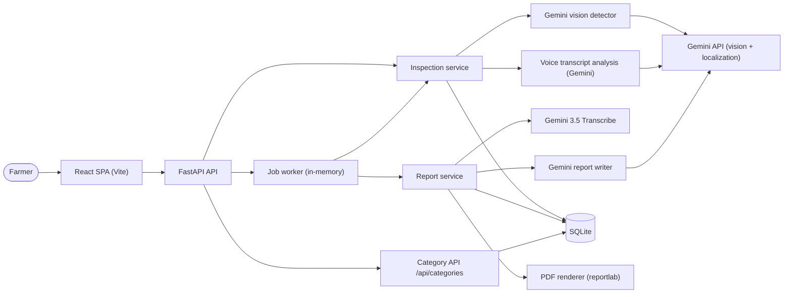
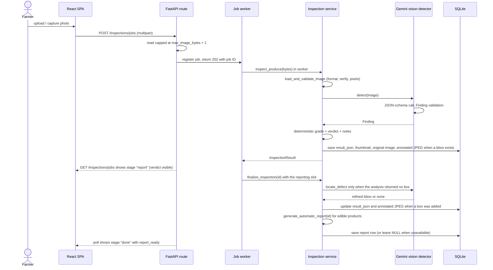
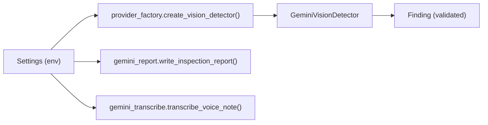

# Architecture — Visual Defect Inspector

Software-only product grading for farmers. A photo or voice note goes in, a validated AI finding and
deterministic grading rules come out as a verdict, quality grade, and recommended action, and an
AI-written PDF report is generated automatically for every edible product. The web interface is
branded **FieldMark**. This document describes the system as it is implemented, not as it is planned;
the README keeps the short version for first-time readers.

## 1. Purpose and scope

**Goals.** Let a farmer upload or capture a product photo, receive a pass/defect verdict with a
confidence score and a plain-language explanation, keep a local inspection history, and download
a professional PDF report — generated automatically, with optional voice-note context captured at
inspection time.

**Non-goals (out of scope per the project SOW).** Hardware and sensors, user accounts,
multi-tenancy, payments, production deployment and scaling, and training models from scratch.
Inference uses a hosted Gemini model behind a swappable detector interface; there is no alternate
vision provider in this build.

**Chosen user type.** Farmer (product grading after harvest): bruises, rot, mold, and deformities
on photos or spoken descriptions of the configured inspection categories, with quality grades
(A / B / Reject) and sell-or-discard advice.

## 2. Technology stack

### 2.1 Backend

- **Python 3.12+**, managed with `uv` (`pyproject.toml`, `uv.lock`); no pip.
- **FastAPI** is the HTTP framework. `app/main.py` creates the app, installs CORS middleware for
  `FRONTEND_ORIGIN`, mounts two `APIRouter`s, and validates prompt templates and cleans up stale job
  uploads in its lifespan. Routes declare typed `Annotated` parameters (`File()`, `Form()`,
  `Query()`), use `UUID` path parameters and `response_model` for responses, and map domain errors to
  `HTTPException` status codes. Blocking work — image validation, SQLite, and AI calls — is offloaded
  with `run_in_threadpool` so the event loop stays responsive. Synchronous uploads wait only for
  validation and the first vision call; refinement and PDF generation run in `BackgroundTasks`. The
  web UI instead submits background jobs through `POST /inspections/jobs`, which returns 202 with a
  job ID and runs the same pipeline in a worker with bounded concurrency.
- **Pydantic v2** validates every model response and API payload in `app/ai/schemas.py`
  (`extra="forbid"` on report text, value bounds, enums, job and review models).
  **pydantic-settings** `BaseSettings` in `app/core/config.py` loads typed settings from the
  environment and `.env`; the Gemini key is held as `SecretStr`.
- **AI client**: the `google-genai` SDK is used for every hosted call — photo analysis and defect
  localization (`produce_gemini.py`), report writing (`gemini_report.py`), transcript analysis
  (`voice_analysis.py`), and Gemini 3.5 Transcribe (`gemini_transcribe.py`). Vision calls implement
  the `VisionDetector` callable protocol in `app/ai/providers.py`; `client_factory.py` caches clients
  and bounds request timeouts.
- **Pillow** validates and decodes uploads, writes thumbnails, draws bounding boxes on annotated
  photos, and resizes/JPEG-encodes images before they are sent to Gemini (`image_encoding.py`).
  **ReportLab** builds the one-page PDF with `SimpleDocTemplate`, platypus `Flowable`s, and direct
  `Canvas` drawing (`app/reports/pdf_renderer.py`).
- **PyYAML** loads the four validated prompt templates in `app/ai/prompt_templates/` and the
  allowed-fruit list in `app/services/fruits.yaml`; **python-multipart** enables multipart uploads.
- **Uvicorn** serves the ASGI app (`uv run uvicorn app.main:app --reload` locally; the container runs
  it as a non-root user).
- **Quality tooling**: ruff (lint and format), pyright (types), pytest + pytest-cov, and httpx for
  API tests.

### 2.2 Frontend

- **TypeScript and React 19** with strict compiler options (`noUnusedLocals`, `noUnusedParameters`),
  so unused imports and variables fail the build.
- **Vite 8** with `@vitejs/plugin-react` builds the bundle (`tsc -b && vite build`). In development
  the Vite server proxies `/health`, `/inspections`, and `/api` to `http://127.0.0.1:8000`; in Docker
  the built bundle is served with `vite preview`.
- **React Router v7** provides the two client-side routes: `main.tsx` installs `BrowserRouter` and
  `App.tsx` maps `/` to `InspectPage` and `/categories` to `CategoriesPage`. SPA fallback for a
  direct `/categories` refresh comes from the Vite dev server or the `vite preview` container; the
  FastAPI process serves only API routes and `/health`.
- **App shell**: `App.tsx` renders the FieldMark top bar (brand, navigation, light/dark theme
  toggle, API status) and the global job toasts. Staged progress is rendered by `InspectPage` while
  a job is active.
- **lucide-react** supplies icons; styling is plain CSS (`index.css`, `App.css`) — no CSS framework.
  `PhotoLightbox.tsx` is a shared, keyboard-accessible full-size evidence-photo viewer used by both
  the result panel and the review drawer.
- **API layer**: every backend call goes through `frontend/src/services/api.ts` (inspections, jobs,
  reports, history, health) and `frontend/src/services/categories.ts`, using typed response models
  and a shared `ApiError`. Requests use a base-URL helper driven by `VITE_API_BASE_URL`, with a
  90-second timeout for synchronous inspections and a 15-second timeout for job submission.
  `InspectionJobsProvider` sits above the router, polls `GET /inspections/jobs`, and publishes
  toasts and the last completed result.
- **Quality tooling**: ESLint + oxlint for linting, Prettier for formatting, and the TypeScript
  compiler as a build gate.

### 2.3 Database and file storage

- **SQLite** through Python's standard `sqlite3` module. One database file,
  `data/inspections.sqlite3` by default (`INSPECTION_DB_PATH` overrides it), with four tables:
  `inspections`, `product_categories`, `inspection_reports`, and `app_metadata` (see §7). All queries
  are parameterized; the schema is created and migrated lazily on the first connection.
- **Filesystem storage**: original photos, thumbnails, and annotated JPEGs live in `data/images/`;
  raw uploads for in-flight background jobs live in `data/uploads/`. SQLite stores only relative
  paths. PDF files are never persisted — each report is rebuilt from its stored narrative and
  evidence image at download time.
- **Deployment**: Docker Compose bind-mounts host `./data` at `/app/data`, so history survives
  container restarts and rebuilds. SQLite is intentionally single-instance (see §16).

### 2.4 Framework implementation map

| Framework / library | Role | How it is used here |
|---|---|---|
| FastAPI + Uvicorn | HTTP API and ASGI server | Two `APIRouter`s, typed request/response models, `HTTPException` mapping, threadpool offload, background jobs |
| Pydantic / pydantic-settings | Contracts and configuration | LLM output validation, `SecretStr` key, environment-driven `Settings` |
| google-genai SDK | Hosted AI | Gemini vision, localization, report writing, transcript analysis, and transcription |
| Pillow | Image processing | Format/verify/decompression-bomb checks, thumbnails, 1024-pixel resize, bounding-box annotation |
| ReportLab | PDF rendering | One-page A4 report with custom `Flowable`s and `Canvas` drawing |
| PyYAML | Prompt and fruit configuration | Loads four prompt templates and `fruits.yaml` for category validation |
| sqlite3 | Persistence | Parameterized queries, lazy schema migration, seeding flag |
| React + React Router | Web UI | Two pages, client-side routing, loading/empty/error states, lightbox |
| Vite | Build and dev proxy | Bundles TypeScript and proxies API calls during development |
| pytest / ruff / pyright | Backend quality gates | Deterministic mocked tests, lint/format, static typing |
| ESLint / oxlint / Prettier | Frontend quality gates | Linting and formatting checks |
| Docker Compose | Local deployment | Two containers, runtime `.env`, persistent `./data` volume |

## 3. Feature list

### 3.1 Inspection

- **Photo input**: upload an image or capture one with the device camera in the browser
  (`InspectPage.tsx`, `POST /inspections/product` or the job endpoint).
- **Voice input**: record a voice note in the browser with a live microphone waveform or upload an
  audio file; Gemini 3.5 Transcribe produces the transcript, and Gemini transcript analysis extracts
  a finding from it. Voice-only inspections use the same endpoints without a photo.
- **AI finding**: the Gemini vision detector returns a schema-validated `Finding` with the detected
  product, edibility, condition, confidence, defect types, severity, visual observation, and
  bounding box.
- **Verdict and grade**: deterministic rules produce `pass` / `defect` / `needs_review`, a quality
  grade (A / B / Reject / Needs manual review), plain-language verdict notes, and a recommended next
  action suited to a farmer (sell, discard, or re-inspect). The confidence score is returned by the
  API, drawn in the PDF, and shown in both the web result panel and the saved-inspection review
  overlay.
- **Defect location**: the analysis bounding box, optionally refined by a second-stage localization
  call, is drawn into a saved annotated JPEG and shown in the PDF and web UI.
- **Evidence viewer**: the result panel and review overlay open original and annotated photos in a
  shared full-screen lightbox with a caption, backdrop click, and Escape-to-close.
- **Outside-category products**: edible products outside the active categories are graded normally
  and flagged as out of category; non-edible items are shown as unsupported with no grade.
- **PDF report**: every edible product gets an automatically generated Gemini-written narrative with
  a deterministic fallback. The one-page PDF includes the report ID, date, user type, original and
  annotated photos, verdict, confidence, defect types, severity, findings, and next steps, and is
  rebuilt on download. A voice note's transcript and context are folded into the narrative; a
  contradiction between audio and photo is called out instead of being silently resolved.

### 3.2 History and categories

- **Inspection history**: a reverse-chronological, paginated list with thumbnail, date, produce
  type, verdict, grade, transcript, and report availability, plus verdict/unsupported filters,
  skeleton loading and an illustrated empty state, thumbnail/original/annotated image endpoints,
  and a clear-history action that removes rows and images.
- **Inspection review**: clicking a history entry opens a focus-trapped, read-only overlay with a
  skeleton loading state that replays everything in the PDF — full result (grade, verdict,
  confidence, defects, severity, notes, action), original and annotated photos, transcript, and the
  stored written report narrative — so a past inspection can be reviewed without re-downloading the
  PDF. Photos open in the shared lightbox; the overlay also keeps the PDF download action.
- **Category management**: list, create, rename, enable, disable, and delete products with an
  optional emoji; four seeded defaults; a fruit allowlist with suggested-fruit input hints;
  active/disabled grouping and an illustrated empty state; guards that keep at least one category
  active and prevent deleting a category referenced by saved inspections.
- **Defect relocation**: an API action to re-locate the defect on older inspections that have no
  stored bounding box.

### 3.3 Platform

- **Single hosted provider** selected in configuration: Gemini handles vision, localization,
  reporting, transcript analysis, and transcription. No provider switch is exposed.
- **Environment-driven configuration** with a committed `.env.example`, `SecretStr` key handling,
  and input size/format limits.
- **Single-command Docker deployment** with a backend healthcheck and a persistent history volume.
- **Interactive API docs** at `/docs` and a `/health` endpoint.
- **Automated checks**: 148 tests with mocked AI clients, a coverage report, and lint/format/type
  gates (see §15).

## 4. System context



The browser talks only to the FastAPI process, which also serves the category API and `/health`.
Every hosted call goes to Gemini. Photos use a structured-JSON vision call; voice notes always use
Gemini 3.5 Transcribe for transcription, whichever analysis path produced the verdict.

## 5. Components

| Path | Responsibility |
|---|---|
| `app/api/routes_inspection.py` | HTTP boundary: jobs, multipart parsing, size/format guards, domain-to-HTTP error mapping, history/evidence/report routes, pagination limits |
| `app/api/routes_categories.py` | Category API: list, create, rename/enable/disable, delete |
| `app/services/inspection_service.py` | Image validation (PIL), active-category loading, deterministic grading, verdict notes, voice grading, finalization, defect relocation, persistence |
| `app/services/job_service.py` | In-memory job registry, upload storage, background worker, concurrency limits, and staged status/report-ready updates |
| `app/services/category_service.py` | Category validation, `fruits.yaml` allowlist, slug generation, limits, and lifecycle rules |
| `app/services/report_service.py` | Orchestrates transcription reuse, Gemini narrative, PDF rendering, deterministic fallback, and report persistence |
| `app/ai/provider_factory.py` | Builds the configured Gemini detector from settings (no network at construction) |
| `app/ai/client_factory.py` | Caches one Gemini client per credential (standard and v1beta for transcription) with bounded request timeouts |
| `app/ai/produce_gemini.py` | Gemini vision provider: JSON response schema for analysis and defect localization, transient-error fallback chain |
| `app/ai/image_encoding.py` | Resize and JPEG/base64 encoding shared by the vision provider |
| `app/ai/gemini_report.py` | Structured one-shot report writing with validated JSON output |
| `app/ai/gemini_transcribe.py` | Gemini 3.5 Transcribe for all voice notes (inspections and PDF reports) |
| `app/ai/transcription.py` | Single transcription entry point used by voice-only inspections |
| `app/ai/voice_analysis.py` | Turn a transcript into a validated `Finding`, with a deterministic keyword fallback |
| `app/ai/gemini_errors.py` | Actionable, credential-free Gemini error messages and quota-exhaustion detection |
| `app/ai/errors.py` | Shared `ReportAIError` for transcription, transcript analysis, and report-writing failures |
| `app/ai/model_info.py` | Summarize configured models for startup/job logs (no credentials) |
| `app/ai/schemas.py` | Pydantic contracts: `Finding`, `InspectionResult`, `InspectionReportText`, history, review, and job models |
| `app/ai/prompt_config.py` | Loads, validates, caches, and substitutes the YAML prompt templates |
| `app/ai/prompt_templates/*.yaml` | Editable prompt text: inspection, localization, report, and voice analysis |
| `app/ai/prompts.py` | Stable facade exposing the loaded vision prompts to providers |
| `app/reports/pdf_renderer.py` | One-page reportlab PDF: metadata, evidence photos, quick-scan card, narrative |
| `app/storage/inspection_repository.py` | Parameterized SQLite access, image/report paths, schema migration |
| `app/storage/category_repository.py` | Category persistence and default seeding in SQLite |
| `app/core/config.py` | Environment-driven `Settings` for models, limits, prompts, and storage paths |
| `app/main.py` | CORS, lifespan prompt validation/upload cleanup, model logging, routes, `/health` |
| `frontend/src/services/api.ts` | Inspection/job/report/history API boundary: typed calls, `ApiError`, URL building |
| `frontend/src/services/categories.ts` | Category API calls and types |
| `frontend/src/context/InspectionJobsContext.tsx` | Provider above the router: submits jobs, polls status, toasts, last completed result |
| `frontend/src/context/jobsContext.ts` | Context type and shared job/toast contracts |
| `frontend/src/context/useInspectionJobs.ts` | Hook used by pages to read the job manager |
| `frontend/src/App.tsx` | App shell, FieldMark top bar, theme, API status, routes, and global toasts |
| `frontend/src/pages/InspectPage.tsx` | Upload/camera/voice with live waveform, staged progress, result panel with confidence, lightbox, history filters and skeletons, clear, review launcher |
| `frontend/src/components/ReviewDrawer.tsx` | Focus-trapped read-only review overlay with skeleton loading: full result, evidence photos, transcript, report narrative, lightbox |
| `frontend/src/components/PhotoLightbox.tsx` | Shared full-size evidence-photo viewer with keyboard and backdrop closing |
| `frontend/src/pages/CategoriesPage.tsx` | Category list with active/disabled grouping, suggestions, empty-state CTA, add/rename/enable/disable/delete |
| `frontend/src/utils/audio.ts` | Browser recording/silence helpers for voice notes |

## 6. Data flow

### 6.1 Inspection



The synchronous `POST /inspections/product` endpoint follows the same service steps but returns the
`InspectionResult` after persistence and runs `finalize_inspection` as a FastAPI background task.
The job-based flow only differs in how work is queued, observed, and reported to the browser.

### 6.2 Automatic PDF report with fallback

```mermaid
sequenceDiagram
    actor F as Farmer
    participant UI as React SPA
    participant API as FastAPI route
    participant S as Inspection service
    participant R as Report service
    participant W as Gemini report writer
    participant DB as SQLite
    F->>UI: upload or capture a photo / record a voice note
    UI->>API: POST /inspections/jobs
    API-->>UI: 202 job ID
    API->>S: inspect_produce(image) or inspect_from_voice(audio) (queued work)
    S->>DB: save result, thumbnail, original image (voice notes: result + transcript)
    Note over S: verdict is available; report_available = false
    Note over S: finalize_inspection(id) runs after the verdict in the reporting slot
    S->>R: generate_automatic_report(id) for edible products and manual-review voice notes
    R->>DB: load original image + stored result
    Note over R: Voice-note transcripts were produced by Gemini 3.5 Transcribe at inspection time and stored on the result
    R->>W: write narrative from result
    alt AI narrative succeeds
        W-->>R: validated InspectionReportText
    else AI or rendering fails
        R->>R: build deterministic report text, log failure
    end
    R->>R: reportlab render (original photo + bbox drawn in memory)
    R->>DB: upsert report narrative (no PDF is stored)
```

For both photo and voice inspections the report portion of this flow runs after the verdict has been
published, so a freshly returned result has `report_available=false` until the report row is saved.
The UI polls the job until `report_ready` is set to reveal the download button. Transcription and
transcript analysis stay on the evidence-gathering path because they are the basis for a voice-only
verdict.

Every edible product, including fruit outside the inspection categories, gets the same report
layout; a voice note with no identified product is kept as a manual-review record and also gets a
report. Non-edible photo items get no PDF. When AI report writing fails, the deterministic narrative
is used instead; if that fallback also fails, no report row is stored and the interface shows the
report as unavailable. Voice-note transcripts are treated as untrusted evidence.

The PDF itself is not stored. `GET /inspections/{id}/report` rebuilds it from the saved narrative,
result, and original photo on every download. The API also accepts `POST /inspections/{id}/report`
with a voice note: Gemini transcribes it, the stored narrative is replaced with a narrated version,
and the rebuilt PDF is returned as a download. The web UI does not expose this update action.

### 6.3 History and clearing

`GET /inspections/history` returns reverse-chronological summaries with `report_available` and
`report_source_available` flags. `GET /inspections/history/{id}` returns the full stored
`InspectionResult` plus the optional report narrative for the review overlay; a corrupt report
narrative is treated as unavailable rather than failing the whole response.
`DELETE /inspections/history` deletes database rows and removes the `images/` and `reports/`
directories; `data/uploads/` is managed by the job lifecycle instead (per-job deletion plus startup
cleanup). `GET .../thumbnail` streams the 192×192 JPEG preview; `GET .../original` and
`GET .../annotated` stream the browser-friendly evidence photos used by the result panel, review
overlay, and lightbox (the annotated view can be drawn on demand from stored coordinates).

### 6.4 Background inspection jobs

The React app uses `POST /inspections/jobs` rather than the synchronous inspection endpoint. The
route validates the upload, writes the raw bytes under `data/uploads/`, creates an in-memory job,
and returns **202** with a job ID immediately. `process_job()` runs in a FastAPI background task:
it reads the upload, calls `inspect_produce()` or `inspect_from_voice()` with the job's
`inspection_id`, and publishes the verdict immediately by marking the job `completed` with stage
`report`. Localization and report generation then continue in `_finish_report()` with a separate
reporting slot; a reporting failure cannot turn an already delivered verdict into a failed job.
Each stage logs its duration (validation, vision, persistence, report writing, PDF rendering) so
slow hosted calls can be identified from the logs. At most two jobs analyze concurrently and at most
one report is finished at a time; failures are recorded on the job rather than propagated to the
client. Actionable quota-exhaustion messages are preserved as job errors.

`GET /inspections/jobs` and `GET /inspections/jobs/{id}` expose job state to any page. The job
manager in `InspectionJobsProvider` lives above React Router, so switching from Inspect to
Categories does not cancel or forget a job: a toast announces the verdict, and returning to Inspect
reopens it. While a job is active, `InspectPage` shows a staged progress bar
(`validating` → `analyzing` → `report` → `done`) with a stage label; while the report is still being
written the verdict is already visible with a "Preparing PDF…" note and the progress bar continues
until `report_ready` is set. The result panel is session-only: a browser refresh clears it, and a
stale result is never shown while another job is analyzing. Jobs are in-memory and therefore lost on
server restart; startup clears orphaned upload files. The older synchronous endpoints remain
available for API consumers.

## 7. Data model

Single SQLite file (default `data/inspections.sqlite3`), created and migrated lazily on first
connection. All queries are parameterized.

```sql
CREATE TABLE inspections (
    inspection_id       TEXT PRIMARY KEY,
    created_at          TEXT NOT NULL,    -- ISO-8601 UTC
    produce_type        TEXT NOT NULL,    -- matched category slug, or "unknown"
    detected_item       TEXT NOT NULL DEFAULT '',  -- real product name (e.g. grapes)
    verdict             TEXT NOT NULL,    -- pass | defect | needs_review
    grade               TEXT NOT NULL,    -- A | B | Reject | Needs manual review
    thumbnail_path      TEXT,             -- relative to the data directory
    original_image_path TEXT,             -- relative to the data directory
    result_json         TEXT              -- serialized InspectionResult
);

CREATE TABLE product_categories (
    slug            TEXT PRIMARY KEY,    -- stable slug used by inspection results
    display_name    TEXT NOT NULL,
    emoji           TEXT NOT NULL DEFAULT '',
    is_active       INTEGER NOT NULL DEFAULT 1,
    created_at      TEXT NOT NULL
);

CREATE TABLE inspection_reports (
    inspection_id   TEXT PRIMARY KEY,    -- one report per inspection (upserted)
    report_id       TEXT NOT NULL UNIQUE,
    created_at      TEXT NOT NULL,
    user_type       TEXT NOT NULL,       -- farmer
    transcript      TEXT NOT NULL,       -- "" when no voice note
    report_text_json TEXT NOT NULL,      -- validated InspectionReportText
);

CREATE TABLE app_metadata (
    key             TEXT PRIMARY KEY,    -- e.g. categories_seeded
    value           TEXT NOT NULL
);
```

`produce_type` records which configured category matched (`"unknown"` for anything outside the
active categories), while `detected_item` keeps the actual product name such as "grapes". Both are
stored as columns; older databases gain `detected_item` on first use, backfilled from `result_json`.
The UI, PDF, and history API show `detected_item`.

The original four categories are seeded once per database, tracked by the `categories_seeded` row in
`app_metadata`. Active category slugs are loaded for every new inspection and passed to the vision
prompt. Renaming changes only `display_name`; the slug stays stable. Disabling sets `is_active = 0`
and removes the category from future prompts. Deletion is allowed only when no stored inspection
references the slug; otherwise the API asks the client to disable it instead. At least one category
must remain active, and new categories must name a fruit in `fruits.yaml`.

Images are files under the data directory: `data/images/{inspection_id}_original.bin`,
`data/images/{inspection_id}_thumbnail.jpg`, and
`data/images/{inspection_id}_annotated.jpg`. SQLite stores only metadata and relative paths; PDFs
are rebuilt on download and never stored, so the database stays small and portable. Raw uploads for
in-flight jobs are written to `data/uploads/{job_id}.bin` and deleted when the job finishes.

A legacy migration rebuilds databases that still have `thumbnail` and `original_image` BLOB
columns: existing BLOBs are written to `data/images/`, their paths are stored, and the BLOB columns
are removed. Legacy rows without a source photo are rejected for reporting with HTTP 409 rather
than fabricated.

**Retention rules.** Every successful inspection stores the full result and metadata in SQLite,
with the thumbnail and original photo on disk. Clearing history deletes the report and image
directories along with the database rows. Images are never stored as BLOBs in SQLite.

## 8. API surface

| Method | Path | Success | Client errors | Provider/server errors |
|---|---|---|---|---|
| POST | `/inspections/product` | 200 `InspectionResult` | 400 invalid image/audio, 413 too large | 500 storage, 502 detection |
| POST | `/inspections/produce` (legacy alias) | 200 `InspectionResult` | same | same |
| POST | `/inspections/tomato` (legacy alias) | 200 `InspectionResult` | same | same |
| POST | `/inspections/jobs` | 202 `InspectionJob` (job ID) | 400 neither/both files or unreadable voice note, 413 too large | 500 storage |
| GET | `/inspections/jobs` | 200 list of recent jobs | — | — |
| GET | `/inspections/jobs/{id}` | 200 `InspectionJob` | 404 | — |
| GET | `/inspections/history?limit&offset` | 200 page (limit 1–100, default 20) | 422 invalid query | 500 |
| GET | `/inspections/history/{id}` | 200 `InspectionDetail` (result + optional report) | 404 | 500 |
| DELETE | `/inspections/history` | 204 | — | 500 |
| GET | `/inspections/history/{id}/thumbnail` | 200 JPEG | 404 | 500 |
| GET | `/inspections/history/{id}/original` | 200 JPEG | 404 | 500 |
| GET | `/inspections/history/{id}/annotated` | 200 JPEG | 404 | 500 |
| POST | `/inspections/{id}/relocate` | 200 `InspectionResult` | 404 not found, 409 no defect/photo | 502 vision, 500 storage |
| POST | `/inspections/{id}/report` | 200 PDF attachment | 400 invalid audio / transcript too long, 413 audio too large, 409 no source photo, 422 missing/invalid `user_type` | 500 storage/render, 502 AI |
| GET | `/inspections/{id}/report?download=true` | 200 PDF attachment | 404 | 500 |
| GET | `/api/categories` | 200 `{"items":[...]}` | — | 500 |
| POST | `/api/categories` | 201 category | 400 invalid/reserved name, 409 duplicate/limit | 500 |
| PATCH | `/api/categories/{slug}` | 200 category | 400 invalid/last active, 404, 409 limit | 500 |
| DELETE | `/api/categories/{slug}` | 204 | 400 last active, 404, 409 in use | 500 |
| GET | `/health` | 200 `{"status":"ok"}` | — | — |

Inspection route parameters are typed as `UUID`, so malformed identifiers are rejected by FastAPI
before reaching the service layer. Job IDs and inspection IDs in responses are UUID strings. The
report `POST` route requires a `user_type` form field (currently only `farmer` is supported) and
regenerates the stored narrative; it accepts an optional voice note. The two legacy inspection
aliases still work at runtime but are hidden from `/docs` with `include_in_schema=False`.

## 9. AI layer and model configuration



- **One detector implementation.** `VisionDetector` is a callable protocol
  (`__call__(image) -> Finding`) in `app/ai/providers.py`; `GeminiVisionDetector` is the only
  implementation and raises `DetectionError` on failure. There is no `VISION_PROVIDER` switch.
- **Editable prompts.** Prompt text lives in four YAML files under `app/ai/prompt_templates/`
  (inspection, localization, report, voice analysis). `app/ai/prompt_config.py` validates each file
  against a Pydantic schema, substitutes `${placeholders}` such as the active category list, caches
  the result, and fails fast on missing or malformed configuration at startup. The default directory
  is bundled in the image; `PROMPT_TEMPLATES_DIR` can point to a mounted folder to edit prompts
  without a rebuild. `app/ai/prompts.py` keeps the original public API for providers and tests.
- **Client reuse and latency bounds.** `app/ai/client_factory.py` caches one Gemini client per
  credential — plus a separate `v1beta` client for transcription — with a bounded request timeout
  (`GEMINI_TIMEOUT_MS`). Transient 429/5xx errors in vision fall back to up to `GEMINI_MAX_FALLBACKS`
  other models from `GEMINI_FALLBACK_MODELS` with a short backoff. `gemini_errors.py` recognizes an
  exhausted daily quota and raises `QuotaExhaustedError` immediately instead of walking the fallback
  chain.
- **Vision** (`gemini-4-hydrogen` by default) receives an inline JPEG resized to at most 1024 px
  with `responseMimeType=application/json`, a `responseSchema`, and temperature 0. A focused
  second-stage call (`gemini-3.5-flash-lite`) supplies coordinates only when the analysis found a
  defect but no box.
- **Report path.** `GEMINI_REPORT_MODEL` (`gemini-3.5-flash-lite` by default) writes the validated
  report narrative with a structured JSON schema. The same model, with the vision `Finding` schema,
  turns voice transcripts into findings in `voice_analysis.py`; if that call fails, a deterministic
  keyword reader supplies a conservative finding.
- **Transcription path.** All voice notes use `GEMINI_TRANSCRIPTION_MODEL`
  (`gemini-3.5-transcribe` by default) via the v1beta client's `files.upload` +
  `interactions.create` in verbatim mode; the uploaded file is deleted afterwards. There is no
  alternate provider. The transcript is stored on the result and passed to the report writer as
  untrusted evidence.
- **Validation.** Model output is never trusted: `Finding` bounds confidence to [0, 1], discards
  non-normalized or unordered bounding boxes, and caps `visual_observation` at 240 characters.
  `InspectionReportText` forbids extra fields and cross-checks the voice-note relation: a
  `conflicts` relation requires a non-empty explanation, and an explanation without a conflict is
  rejected.

## 10. Deterministic grading rules

All thresholds are constants in `inspection_service.py`; the model only reports observations.

| Condition | Result |
|---|---|
| Product is not an edible item | No quality grade; shown as an unsupported item |
| Edible product outside the categories (for example guava) | Normal fresh/rotten rules, flagged as outside the categories |
| Product type unknown, or model unsure | Needs manual review |
| Rotten, confidence ≥ 0.60 | Reject + separate/discard advice |
| Rotten, confidence < 0.60 | Needs manual review |
| Fresh, confidence < 0.40 | Needs manual review |
| Fresh, severity high, or mold reported | Needs manual review |
| Fresh, confidence ≥ 0.70, severity none | Grade A + premium advice |
| Everything else fresh | Grade B + standard advice |

Verdicts follow the grade: review → `needs_review`, Reject or any reported defect → `defect`,
otherwise `pass`. `verdict_notes` explain the decision without exposing thresholds or repeating
model-reported confidence percentages. The vision model reports `detected_item` and
`item_is_fruit`; voice transcript analysis produces the same `Finding` fields, so both evidence types
pass through the same grading rules. The service sets `in_inspection_categories` so the interface can
show a normal result for any edible product and a plain "Unsupported item" result for everything
else.

## 11. Error handling

| Layer | Failure | Handling |
|---|---|---|
| Route | Oversized image/voice note | Read capped at limit + 1 byte → 413 |
| Service | Bad image (format, verify, decompression bomb, OS) | `InvalidImageError` → 400, logged |
| Provider | Gemini API error, invalid JSON, missing key | `DetectionError` → 502 on the synchronous path, logged |
| Provider | Exhausted daily quota | `QuotaExhaustedError` with an actionable message; skips fallback models and is preserved as a job error |
| Transcription | Gemini API error, missing key, empty/silent audio | `ReportAIError` with an actionable message |
| Voice analysis | Gemini failure or unusable JSON | Deterministic keyword fallback finding |
| Report AI | Gemini model unavailable/rate-limited/invalid JSON/no response | Distinct actionable messages via `gemini_errors.py` → 502 |
| Report AI | Contradiction between transcript and visual result | Required conflict explanation, validated |
| Service | Transcript longer than 800 characters | 400 with a clear message on the synchronous report route; on the job path the report is marked unavailable (`report_ready=false`) without failing the delivered verdict |
| Relocation | Unknown/unsuitable inspection, vision or storage failure | 404 / 409 / 502 / 500 with specific messages |
| Storage | Any `sqlite3.Error` / `OSError` | `HistoryStorageError` → 500, logged |
| PDF | Layout/render errors (`LayoutError`, `OSError`) | `InspectionReportError` → 500 |

Errors are chained with `raise ... from exc` and logged through module loggers (never `print`).
Logs record exception *types*, never keys or personal data.

## 12. Security boundaries

- **Secrets** live only in environment variables / the local `.env`; `.env` is gitignored and
  excluded from the Docker build context. The Docker image contains no key material.
- **Input validation at the boundary.** Pydantic validates every model response; routes enforce
  file-type allowlists (JPEG/PNG/WEBP images; flac/m4a/mp3/mpga/ogg/wav/webm/aac/mp4 audio), size
  limits (10 MB image, 25 MB voice note), and a 25-megapixel decompression-bomb guard. Jobs write
  uploads to server-generated UUID filenames under `data/uploads/`.
- **Prompt injection.** Voice-note transcripts are treated as untrusted data: the report prompt
  instructs the model to treat transcript text as observations, never instructions, and to describe
  both sources when they conflict instead of obeying the transcript.
- **LLM output as untrusted input.** Both the vision `Finding` and the report narrative are
  schema-validated before use; unexpected fields are rejected (`extra="forbid"`).
- **SQL injection.** All statements are parameterized; identifiers come from code, not input.
- **Path traversal.** No user-supplied path is ever opened: images and audio are processed in
  memory, database and upload paths come from configuration or generated IDs, and route parameters
  are UUIDs.
- **No `eval` / `pickle`** on user data; JSON only.

## 13. Configuration

| Variable | Default | Purpose |
|---|---|---|
| `GEMINI_API_KEY` | *(empty)* | Required for vision, localization, report writing, transcript analysis, and transcription |
| `GEMINI_VISION_MODEL` | `gemini-4-hydrogen` | Photo analysis model |
| `GEMINI_LOCALIZATION_MODEL` | `gemini-3.5-flash-lite` | Second-stage defect box model |
| `GEMINI_REPORT_MODEL` | `gemini-3.5-flash-lite` | Report narrative and voice-transcript analysis model |
| `GEMINI_FALLBACK_MODELS` | `gemini-3.8-flash,gemini-3.6-flash,gemini-3.5-flash-lite` | Tried on transient model errors |
| `GEMINI_MAX_FALLBACKS` | `2` | Maximum fallback models tried after the primary (`.env.example` sets `3`) |
| `GEMINI_FALLBACK_BACKOFF_SECONDS` | `0.5` | Pause between consecutive fallback attempts |
| `GEMINI_TIMEOUT_MS` | `20000` | Request timeout for cached Gemini clients |
| `GEMINI_TRANSCRIPTION_MODEL` | `gemini-3.5-transcribe` | Transcription model for all voice notes |
| `PROMPT_TEMPLATES_DIR` | `app/ai/prompt_templates` | Directory of validated YAML prompt templates |
| `INSPECTION_DB_PATH` | `data/inspections.sqlite3` | Absolute in Docker (`/app/data/...`) |
| `FRONTEND_ORIGIN` | `http://localhost:3000` | Allowed CORS origin for the separate frontend |
| `VITE_API_BASE_URL` | `http://localhost:8000` | API URL baked into the frontend at build time |
| `WEB_PORT` | `3000` | Host port for the frontend container |
| `LOG_LEVEL` | `INFO` | Backend log level |

Image/audio limits and allowed formats are also `Settings` fields (`max_image_bytes`,
`max_voice_note_bytes`, `max_image_pixels`, `allowed_formats`) initialized from constants in
`app/core/config.py`; pydantic-settings will accept matching environment variables such as
`MAX_IMAGE_BYTES` to override them. `INSPECTION_DB_PATH` and `PROMPT_TEMPLATES_DIR` resolve to
absolute paths from the project root by default; the relative forms above are the conventional
local/Docker values.

## 14. Deployment

Two containers, two origins. The backend image installs locked Python dependencies with `uv` and
runs Uvicorn as non-root user `inspector` (uid 10001); it serves only API routes and `/health`. The
frontend image builds the Vite bundle with Node and serves it with `vite preview`, including SPA
fallback for routes such as `/categories`. CORS middleware in FastAPI allows the frontend origin
(`FRONTEND_ORIGIN`, default `http://localhost:3000`).

- Docker Compose publishes `8000:8000` for the backend and `${WEB_PORT:-3000}:3000` for the
  frontend, injects `.env` at runtime, and bind-mounts the host `./data/` directory at `/app/data`
  on the backend, so inspection history survives restarts, rebuilds, and `docker compose down`.
  Deleting the host `./data/` directory removes that data, including in-flight job uploads.
- `VITE_API_BASE_URL` is baked into the frontend bundle at build time; rebuild the frontend image
  after changing it. The built-in Vite dev proxy keeps local `npm run dev` working unchanged.
- A `HEALTHCHECK` in the backend image polls `/health` from inside the container.
- SQLite requires a single instance; do not scale to replicas or run on multi-node hosts.

## 15. Testing

`uv run pytest --cov=app --cov-report=term-missing` — 148 tests, 87% line coverage.

- `tests/test_api.py` — route behavior, status-code mapping, pagination, oversized/invalid
  uploads, report and image routes, and an end-to-end happy path through the API with a mocked detector.
- `tests/test_inspection.py` — grading rules, verdict notes, quota-error propagation, invalid images.
- `tests/test_providers.py` — Gemini factory construction, key handling, JSON-schema responses,
  quota detection, and fallback behavior.
- `tests/test_reports.py` — Gemini narrative validation, conflict handling, annotated photo rendering,
  one-page layout constraints, actionable AI error mapping.
- `tests/test_categories.py` — category seeding, create/rename/disable/delete rules, fruit allowlist,
  and dynamic categories in new inspections.
- `tests/test_transcription.py` — Gemini upload/transcribe requests, MIME mapping, uploaded-file
  cleanup, empty/silent audio, and the single transcription entry point.
- `tests/test_voice_analysis.py` — transcript analysis with a mocked model and keyword fallback.
- `tests/test_jobs.py` — job registry and staging, concurrency limits, verdict/report handoff, upload
  cleanup, and actionable job errors.
- `tests/test_model_info.py` — model summary for logs.
- `tests/test_prompt_config.py` — YAML template validation and placeholder substitution.
- `tests/test_config.py` — settings defaults.

Every hosted model call is mocked (`monkeypatch`) in unit tests, so the suite is deterministic and
network-free; no test calls a live provider.

## 16. Limitations and known gaps

- The bounding box is returned by the API, drawn by the backend into a saved annotated JPEG, and
  rendered in the PDF and web UI. Both the result panel and the review overlay display the
  confidence score and open the evidence photos in a full-screen lightbox.
- A photo inspection's PDF is generated after the verdict is published, so the first response reports
  `report_available=false`; the download button appears when the job reports `report_ready`.
  Closing the page early does not cancel the background work.
- Background jobs are in-memory: they are lost on server restart, capped at two concurrent analyses
  and one concurrent report, and only the 50 most recent jobs are retained.
- No audio-duration limit is enforced (size and post-transcription length are).
- The Gemini vision, transcription, voice-analysis, and report paths are implemented and unit-tested
  with mocked clients, but have no documented live run or performance numbers. Inference uses hosted
  API models only; the local-model bonus (quantization/batching metrics) is out of scope.
- The optional multi-inspection summary report from the SOW is not implemented.
- SQLite limits the system to one writer process; concurrent-heavy or multi-node deployments
  would need a different store (explicitly out of scope for the MVP).
