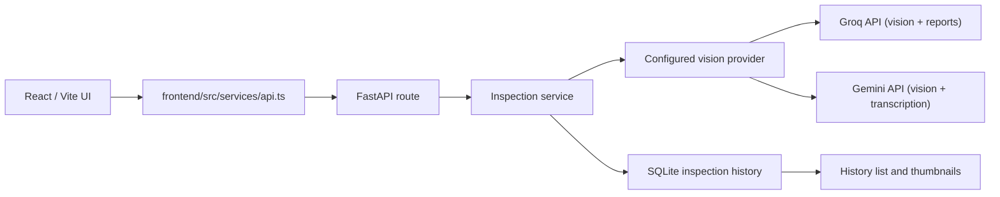

# Visual Defect Inspector

Upload a photo of a fruit and get a pass/defect verdict, a quality grade, a located defect, and a
downloadable PDF report. Built as a software-only MVP for farmers grading produce after harvest.

## Features

- **Photo input** — upload an image or capture one with the device camera in the browser.
- **Voice input** — record a voice note in the browser or upload an audio file; all transcription
  uses Gemini 3.5 Transcribe.
- **AI finding** — detected product, edibility, condition, confidence, defect types
  (bruise / rot / mold / deformity), severity, and a bounding box.
- **Deterministic grading** — A / B / Reject / Needs manual review with plain-language verdict notes
  and sell-or-discard advice.
- **Defect location** — an annotated JPEG is generated from the model's bounding box.
- **PDF report** — a one-page, AI-written report rebuilt on download, with a deterministic fallback
  if AI writing fails.
- **History and categories** — browse past inspections with thumbnails and report status, and manage
  the products the inspector expects.

Full list: [ARCHITECTURE.md — Feature list](ARCHITECTURE.md#3-feature-list).

## Tech stack

- **Backend:** Python 3.12, FastAPI, Pydantic / pydantic-settings, Pillow, ReportLab, SQLite
  (stdlib `sqlite3`), Groq and Google GenAI SDKs. Dependencies managed with `uv`.
- **Frontend:** React 19, TypeScript, Vite, React Router, lucide-react, plain CSS.
- **Tooling:** ruff, pyright, pytest / pytest-cov; ESLint + oxlint, Prettier; Docker Compose.

How each framework is used: [ARCHITECTURE.md — Technology stack](ARCHITECTURE.md#2-technology-stack).

## Getting started

### Prerequisites

- Python 3.12+ and [uv](https://docs.astral.sh/uv/)
- Node.js and npm (for the frontend)
- API keys: `GROQ_API_KEY` (vision and report writing) and `GEMINI_API_KEY` (all voice transcription)
- Optional: Docker with Compose v2

### Run locally

```bash
git clone <repository-url>
cd visual-defect-inspector-api
uv sync
cp .env.example .env
# add GROQ_API_KEY and GEMINI_API_KEY to .env
uv run uvicorn app.main:app --reload
```

In a second terminal:

```bash
cd frontend
npm install
npm run dev
```

Open the Vite URL printed in the terminal (usually `http://localhost:5173`). The dev server proxies
`/health`, `/inspections`, and `/api` to the API on port 8000. API docs: `http://localhost:8000/docs`.

### Run with Docker

```bash
cp .env.example .env   # add both API keys
docker compose up --build -d
```

UI: `http://localhost:3000` · API and docs: `http://localhost:8000`. Set `WEB_PORT` (for example
`WEB_PORT=3001 docker compose up -d`) for a different UI port. History lives in the host `./data/`
directory, so it survives restarts and rebuilds.

## Configuration

Copy `.env.example` to `.env` and never commit real keys. Main variables:

| Variable | Default | Purpose |
|---|---|---|
| `VISION_PROVIDER` | `groq` | Vision provider: `groq` or `gemini` |
| `GROQ_API_KEY` | *(empty)* | Required for Groq vision and report writing |
| `GROQ_VISION_MODEL` | `qwen/qwen3.8-27b` | Groq vision model |
| `GROQ_REPORT_MODEL` | `openai/gpt-oss-20b` | Report narrative model |
| `GEMINI_API_KEY` | *(empty)* | Required for Gemini vision and **all** voice transcription |
| `GEMINI_VISION_MODEL` | `gemini-4-hydrogen` | Gemini analysis model |
| `GEMINI_LOCALIZATION_MODEL` | `gemini-3.5-flash-lite` | Second-stage defect box model |
| `GEMINI_FALLBACK_MODELS` | `gemini-3.8-flash,gemini-3.6-flash,gemini-3.5-flash-lite` | Tried on transient model errors |
| `GEMINI_TRANSCRIPTION_MODEL` | `gemini-3.5-transcribe` | All voice-note transcription |
| `INSPECTION_DB_PATH` | `data/inspections.sqlite3` | SQLite database path |
| `FRONTEND_ORIGIN` | `http://localhost:3000` | Allowed CORS origin |
| `VITE_API_BASE_URL` | `http://localhost:8000` | API URL baked into the frontend at build time |
| `WEB_PORT` | `3000` | Frontend host port in Docker |

Full list: [ARCHITECTURE.md — Configuration](ARCHITECTURE.md#13-configuration).

## API endpoints

| Method | Path | Purpose |
|---|---|---|
| POST | `/inspections/product` | Inspect a photo or a voice note (multipart) |
| GET | `/inspections/history?limit&offset` | Paginated inspection history |
| DELETE | `/inspections/history` | Clear all history, images, and reports |
| GET | `/inspections/history/{id}/thumbnail` | 192×192 preview image |
| GET | `/inspections/{id}/report?download=true` | Rebuild and download the PDF |
| POST | `/inspections/{id}/report` | Add a voice note to a report (API only) |
| POST | `/inspections/{id}/relocate` | Re-locate a defect on an older inspection |
| GET/POST | `/api/categories` | List or create categories |
| PATCH/DELETE | `/api/categories/{slug}` | Rename, enable/disable, or delete a category |
| GET | `/health` | Health check |

Interactive docs are at `http://localhost:8000/docs`. Full status codes:
[ARCHITECTURE.md — API surface](ARCHITECTURE.md#8-api-surface).

## Architecture



The route handles HTTP input and responses, the service validates images and applies grading rules,
and the factory selects a vision implementation from configuration. Report narratives are stored in
SQLite and the PDF is rebuilt on demand at download time, so no PDF files are written to disk.
Component map, data flow, data model, and security notes: [ARCHITECTURE.md](ARCHITECTURE.md).

## Project structure

```text
app/
  api/          FastAPI routes for inspections and categories
  services/     Image validation, grading, transcription and report orchestration
  ai/           Vision providers, transcription, prompts, Pydantic schemas
  storage/      SQLite repositories and migrations
  reports/      ReportLab PDF renderer
  core/         Environment-driven settings
frontend/src/
  pages/        InspectPage and CategoriesPage
  services/     Typed API clients
  utils/        Audio helpers
tests/          Backend tests (AI clients mocked)
sample_images/  Example produce photos for trying the app
data/           Local SQLite database and images (gitignored)
```

## Testing

```bash
# backend: 119 tests, ~87% coverage; AI clients are mocked so the suite is offline
uv run pytest --cov=app --cov-report=term-missing
uv run ruff check .
uv run ruff format --check .
uv run pyright

# frontend
cd frontend
npm run lint
npm run format:check
npm run build
```
