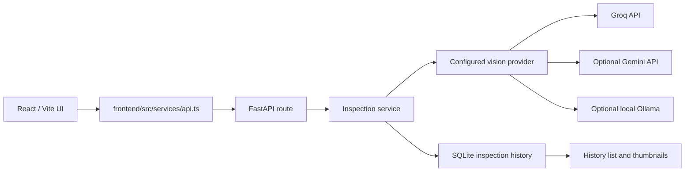

# Visual Defect Inspector

A software-only product grading MVP. A farmer uploads or captures a fruit photo, the configured
vision provider returns a validated visual finding, and deterministic grading rules produce a
verdict and next-step recommendation. Results are indicative and do not assess food safety.

## Architecture



The API route handles HTTP input and responses, the service validates images and applies grading
rules, and the provider factory selects a vision implementation from configuration. Inspection
metadata is saved to SQLite at `data/inspections.sqlite3` by default. Original photos, thumbnails,
and annotated defect images are stored under `data/images/`; SQLite keeps only their file paths.
Report narratives are stored in SQLite and the PDF is rebuilt on demand at download time, so no
PDF files are written to disk. Clearing inspection history deletes the saved images and reports. See
[ARCHITECTURE.md](ARCHITECTURE.md) for the component map, data model, API surface, failure
modes, and deployment details.

## Run locally

Install Python 3.12 and `uv`. From the repository root:

```bash
uv sync
cp .env.example .env
```

Add a Groq API key to the local `.env`, then start the backend:

```bash
uv run uvicorn app.main:app --reload
```

In another terminal, start the frontend:

```bash
cd frontend
npm install
npm run dev
```

Open the Vite URL printed in the terminal. The development server proxies API calls to the local
FastAPI server. Set `VITE_API_BASE_URL` if the API is hosted elsewhere.

## Run with Docker

Docker (with Compose v2) is the only prerequisite — no Python, Node, or `uv` install needed.

```bash
cp .env.example .env
```

Add a Groq API key to the local `.env`, then build and start:

```bash
docker compose up --build -d
```

Open the web UI at **http://localhost:3000**. The API (and Swagger docs) run separately at
**http://localhost:8000**. Set `WEB_PORT` (for example `WEB_PORT=3001 docker compose up -d`) to use
a different host port for the UI, and update `FRONTEND_ORIGIN` in `.env` to match. Set
`VITE_API_BASE_URL` if the API is hosted elsewhere; it is baked into the frontend at build time, so
rebuild the frontend image after changing it.

Useful commands:

```bash
docker compose logs -f backend     # follow API logs
docker compose logs -f frontend    # follow web server logs
docker compose restart backend     # restart the API; inspection history is preserved
docker compose down                # stop both containers; inspection history is preserved
```

Inspection history lives in the host `./data/` folder, bind-mounted at `/app/data`, so it survives
container restarts and rebuilds and can be opened directly with any SQLite viewer. Deleting
`./data/` removes the saved inspections, images, and reports. Secrets come from the runtime `.env`
file and are never baked into the image.

## Result behavior

The vision model names the product in `detected_item` and marks whether it is an edible product
in `item_is_fruit`. Edible products are graded with the same rules even when they are outside the
active inspection categories; those results also state that the product is outside the categories.
Anything that is not an edible product is shown as an "Unsupported item" with no grade or verdict.

Every edible product gets a report narrative generated automatically during the inspection. If the
AI-written narrative fails, deterministic text is used instead; if both fail, no report is stored
and the interface shows that the report is unavailable. The one-page PDF is rebuilt from that
stored narrative whenever you download it — no PDF is written to disk. Non-edible items do not get
a report. An optional voice note updates the stored narrative with spoken context.

## Inspection categories

The Categories page (`/categories`) manages the products the inspector expects. The current
categories are stored in SQLite, seeded with tomato, apple, banana, and orange, and sent to the
vision model for every new inspection. Add a product name and an optional emoji to include it in
future inspections; existing inspections and PDFs keep their original result.

Categories can be renamed, disabled, or deleted. Disabling removes a category from new
inspections while keeping historical records. A category that is referenced by saved inspections
can only be disabled, not deleted. The API is available at `GET/POST /api/categories` and
`PATCH/DELETE /api/categories/{slug}`.

The web app uses client-side routes: `/` for inspection and `/categories` for category
management. The FastAPI server returns `index.html` for `/categories` so the page also works on a
direct refresh or shared link.

## Vision providers

Groq is the default (`VISION_PROVIDER=groq`); set `GROQ_API_KEY` and optionally
`GROQ_VISION_MODEL`.

**Gemini** is available on Google's free tier: set `VISION_PROVIDER=gemini`, add `GEMINI_API_KEY`,
and optionally override `GEMINI_VISION_MODEL` and `GEMINI_LOCALIZATION_MODEL`. It uses structured
JSON response schemas for both the analysis and defect-localization calls. Defaults are
`gemini-4-hydrogen` for analysis and `gemini-3.5-flash-lite` for the second-stage box. If the
selected model is overloaded or rate-limited (HTTP 429/5xx), the detector automatically retries
the next model in `GEMINI_FALLBACK_MODELS` (default: `gemini-3.8-flash`, `gemini-3.6-flash`,
`gemini-3.5-flash-lite`). Free-tier prompts may be used by Google to improve its products, and rate
limits vary, so check your limits in Google AI Studio.

Ollama is an optional local provider, not required to run the default setup. Install Ollama and
pull a vision model such as `qwen2.5vl:7b`, then set `VISION_PROVIDER=ollama`. Configure its
endpoint and model with `OLLAMA_BASE_URL` and `OLLAMA_VISION_MODEL`. The application does not
silently switch providers if the selected provider fails.

## Voice-note transcription

Voice-note-only inspections use `gemini-3.5-transcribe` by default (`TRANSCRIPTION_PROVIDER=gemini`).
Override the model with `GEMINI_TRANSCRIPTION_MODEL`, or set `TRANSCRIPTION_PROVIDER=groq` to use
Groq Whisper instead. Voice notes attached to PDF reports always use Groq Whisper
(`GROQ_TRANSCRIPTION_MODEL`), so a `GROQ_API_KEY` is still required for report writing and those
voice notes. The Gemini flow uploads the audio before transcribing (two requests) and free-tier
content may be used to improve Google's products.

## Inspection history

Every successful inspection stores its result metadata in SQLite, a small thumbnail under
`data/images/`, and the original photo under `data/images/` for PDF evidence. History is available
through `GET /inspections/history`; each thumbnail is served from
`GET /inspections/history/{inspection_id}/thumbnail`. A history item with a stored PDF shows a
download button; otherwise the interface shows that the report is unavailable.

Set `INSPECTION_DB_PATH` to use a different local database path. The default `data/` directory is
ignored by Git.

## Checks

From the repository root:

```bash
uv run ruff check .
uv run ruff format --check .
uv run pyright
uv run pytest --cov=app --cov-report=term-missing
```

From `frontend/`:

```bash
npm run lint
npm run format:check
npm run build
```
