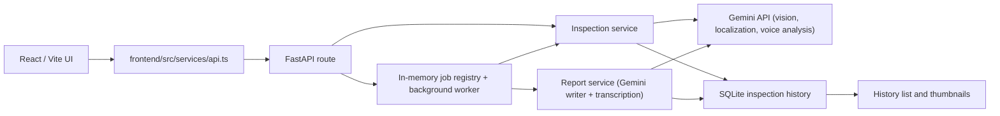

# Visual Defect Inspector

Upload a photo of a fruit and get a pass/defect verdict, a quality grade, a located defect, and a
downloadable PDF report. Built as a software-only MVP for farmers grading produce after harvest.
The web interface is branded **FieldMark**.

## Features

- **Photo input** — upload an image or capture one with the device camera in the browser.
- **Voice input** — record a voice note in the browser or upload an audio file; all transcription
  uses Gemini 3.5 Transcribe. Voice-only inspections are graded from the spoken description.
- **Background jobs** — uploads are queued and processed off the request path. Switch to Categories,
  refresh, or close the tab: the job keeps running, a toast announces the verdict, and the result
  reopens when you return to Inspect. The PDF continues in the background afterward.
- **AI finding** — Gemini returns the detected product, edibility, condition, confidence, defect types
  (bruise / rot / mold / deformity), severity, and a bounding box. The result panel and the review
  overlay show the confidence score and the annotated evidence photo, which open in a full-screen
  lightbox.
- **Editable prompts** — AI instructions live in validated YAML files under `app/ai/prompt_templates/`;
  set `PROMPT_TEMPLATES_DIR` to edit them without rebuilding the image.
- **Deterministic grading** — A / B / Reject / Needs manual review with plain-language verdict notes
  and sell-or-discard advice.
- **Defect location** — an annotated JPEG is generated from the model's bounding box.
- **PDF report** — a one-page, AI-written report rebuilt on download, with a deterministic fallback
  if AI writing fails. The verdict returns as soon as the evidence is analyzed (photo or voice
  note); the report is generated in the same background job and the download button appears when it
  is ready.
- **History and categories** — browse past inspections with thumbnails, report status, and verdict
  filters, and manage the products the inspector expects.
- **Inspection review** — open any saved inspection in a read-only overlay to see the full result,
  evidence photos, transcript, and written report without downloading the PDF again.
- **Field-ready interface** — responsive FieldMark UI with a light/dark theme, staged progress, and
  keyboard-accessible dialogs.

Full list: [ARCHITECTURE.md — Feature list](ARCHITECTURE.md#3-feature-list).

## Tech stack

- **Backend:** Python 3.12, FastAPI, Pydantic / pydantic-settings, Pillow, ReportLab, SQLite
  (stdlib `sqlite3`), and the Google GenAI SDK. Dependencies managed with `uv`.
- **Frontend:** React 19, TypeScript, Vite, React Router, lucide-react, plain CSS.
- **Tooling:** ruff, pyright, pytest / pytest-cov; ESLint + oxlint, Prettier; Docker Compose.

How each framework is used: [ARCHITECTURE.md — Technology stack](ARCHITECTURE.md#2-technology-stack).

## Getting started

### Prerequisites

- Python 3.12+ and [uv](https://docs.astral.sh/uv/)
- Node.js and npm (for the frontend)
- API key: `GEMINI_API_KEY` (vision, localization, voice analysis, transcription, and report writing)
- Optional: Docker with Compose v2

### Run locally

```bash
git clone <repository-url>
cd visual-defect-inspector-api
uv sync
cp .env.example .env
# add GEMINI_API_KEY to .env
uv run uvicorn app.main:app --reload
```

In a second terminal:

```bash
cd frontend
npm install
npm run dev
```

Open the Vite URL printed in the terminal (usually `http://localhost:5173`). The dev server proxies
`/health`, `/inspections`, and `/api` to the API on port 8000. API docs: `http://localhost:8000/docs`.

### Run with Docker

```bash
cp .env.example .env   # add GEMINI_API_KEY
docker compose up --build -d
```

UI: `http://localhost:3000` · API and docs: `http://localhost:8000`. Set `WEB_PORT` (for example
`WEB_PORT=3001 docker compose up -d`) for a different UI port. History lives in the host `./data/`
directory, so it survives restarts and rebuilds.

## Configuration

Copy `.env.example` to `.env` and never commit real keys. Main variables:

| Variable | Default | Purpose |
|---|---|---|
| `GEMINI_API_KEY` | *(empty)* | Required for vision, localization, voice analysis, transcription, and report writing |
| `GEMINI_VISION_MODEL` | `gemini-4-hydrogen` | Photo analysis model |
| `GEMINI_LOCALIZATION_MODEL` | `gemini-3.5-flash-lite` | Second-stage defect box model |
| `GEMINI_REPORT_MODEL` | `gemini-3.5-flash-lite` | Report narrative and voice-transcript analysis model |
| `GEMINI_FALLBACK_MODELS` | `gemini-3.8-flash,gemini-3.6-flash,gemini-3.5-flash-lite` | Tried on transient model errors |
| `GEMINI_MAX_FALLBACKS` | `2` | Maximum fallback models tried after the primary (the committed `.env.example` sets `3`) |
| `GEMINI_FALLBACK_BACKOFF_SECONDS` | `0.5` | Pause between consecutive fallback attempts |
| `GEMINI_TIMEOUT_MS` | `20000` | Request timeout for cached Gemini clients |
| `GEMINI_TRANSCRIPTION_MODEL` | `gemini-3.5-transcribe` | All voice-note transcription |
| `PROMPT_TEMPLATES_DIR` | `app/ai/prompt_templates` | Directory of validated YAML prompt templates |
| `INSPECTION_DB_PATH` | `data/inspections.sqlite3` | SQLite database path |
| `FRONTEND_ORIGIN` | `http://localhost:3000` | Allowed CORS origin |
| `VITE_API_BASE_URL` | `http://localhost:8000` | API URL baked into the frontend at build time |
| `WEB_PORT` | `3000` | Frontend host port in Docker |
| `LOG_LEVEL` | `INFO` | Backend log level |

Full list: [ARCHITECTURE.md — Configuration](ARCHITECTURE.md#13-configuration).

## API endpoints

| Method | Path | Purpose |
|---|---|---|
| POST | `/inspections/jobs` | Queue a photo or voice note (202 with a job ID) |
| GET | `/inspections/jobs` · `/inspections/jobs/{id}` | Job progress and results |
| POST | `/inspections/product` | Synchronous inspect of a photo or a voice note (multipart) |
| GET | `/inspections/history?limit&offset` | Paginated inspection history |
| GET | `/inspections/history/{id}` | Full stored result and written report for one inspection |
| GET | `/inspections/history/{id}/thumbnail` | 192×192 preview image |
| GET | `/inspections/history/{id}/original` | Original photo, normalized to JPEG |
| GET | `/inspections/history/{id}/annotated` | Photo with the detected defect box |
| POST | `/inspections/{id}/relocate` | Re-locate a defect on an older inspection |
| GET | `/inspections/{id}/report?download=true` | Rebuild and download the PDF |
| POST | `/inspections/{id}/report` | Regenerate a stored report narrative, optionally with a voice note (API only) |
| DELETE | `/inspections/history` | Clear all history, images, and reports |
| GET/POST | `/api/categories` | List or create categories |
| PATCH/DELETE | `/api/categories/{slug}` | Rename, enable/disable, or delete a category |
| GET | `/health` | Health check |

Interactive docs are at `http://localhost:8000/docs`. Full status codes:
[ARCHITECTURE.md — API surface](ARCHITECTURE.md#8-api-surface).

## Architecture



The route handles HTTP input and responses, the service validates images and applies grading rules,
and the job worker runs analysis and reporting off the request path. All hosted-model calls go to
Gemini. Report narratives are stored in SQLite and the PDF is rebuilt on demand at download time, so
no PDF files are written to disk. Component map, data flow, data model, and security notes:
[ARCHITECTURE.md](ARCHITECTURE.md).

## Project structure

```text
app/
  api/          FastAPI routes for inspections, jobs, and categories
  services/     Image validation, grading, job worker, and report orchestration
  ai/           Gemini vision/report/transcription clients, prompts, Pydantic schemas
  storage/      SQLite repositories and migrations
  reports/      ReportLab PDF renderer
  core/         Environment-driven settings
frontend/src/
  pages/        InspectPage and CategoriesPage
  components/   ReviewDrawer (read-only review) and PhotoLightbox (full-size photos)
  context/      Background-job provider and hook
  services/     Typed API clients
  utils/        Audio helpers
tests/          Backend tests (AI clients mocked)
data/           Local SQLite database, images, and job uploads (gitignored)
```

## Testing

```bash
# backend: 148 tests, ~87% coverage; AI clients are mocked so the suite is offline
uv run pytest --cov=app --cov-report=term-missing
uv run ruff check .
uv run ruff format --check .
uv run pyright

# frontend
cd frontend
npm run lint
npm run format:check
npm run build
```
