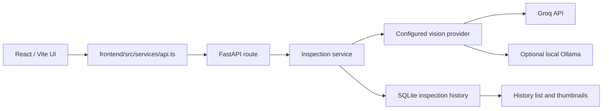

# Visual Defect Inspector

A software-only produce grading MVP. A farmer uploads or captures a fruit photo, the configured
vision provider returns a validated visual finding, and deterministic grading rules produce a
verdict and next-step recommendation. Results are indicative and do not assess food safety.

## Architecture



The API route handles HTTP input and responses, the service validates images and applies grading
rules, and the provider factory selects a vision implementation from configuration. Inspection
results and small JPEG thumbnails are saved to SQLite at `data/inspections.sqlite3` by default.
Original uploaded images are retained locally so inspection reports can include the source photo.
Clearing inspection history deletes the saved images and reports.

## Run locally

Install Python 3.12 and `uv`. From the repository root:

```bash
uv sync
cp .env.example .env
```

Add a Groq API key to the local `.env`, then start the backend:

```bash
uv run uvicorn app.main:app --reload
```

In another terminal, start the frontend:

```bash
cd frontend
npm install
npm run dev
```

Open the Vite URL printed in the terminal. The development server proxies API calls to the local
FastAPI server. Set `VITE_API_BASE_URL` if the API is hosted elsewhere.

## Run with Docker

Docker (with Compose v2) is the only prerequisite — no Python, Node, or `uv` install needed.

```bash
cp .env.example .env
```

Add a Groq API key to the local `.env`, then build and start:

```bash
docker compose up --build -d
```

Open `http://localhost:8000`. The API and the built web UI are served from the same container;
set `APP_PORT` (for example `APP_PORT=8080 docker compose up -d`) to use a different host port.

Useful commands:

```bash
docker compose logs -f app     # follow application logs
docker compose restart app     # restart; inspection history is preserved
docker compose down            # stop the container; inspection history is preserved
docker compose down -v         # stop and delete the saved inspection history
```

Inspection history lives in the `inspection-data` Docker volume mounted at `/app/data`, so it
survives container restarts and rebuilds. Secrets come from the runtime `.env` file and are never
baked into the image.

## Vision providers

Groq is the default (`VISION_PROVIDER=groq`); set `GROQ_API_KEY` and optionally
`GROQ_VISION_MODEL`.

Ollama is an optional local provider, not required to run the default setup. Install Ollama and
pull a vision model such as `qwen2.5vl:7b`, then set `VISION_PROVIDER=ollama`. Configure its
endpoint and model with `OLLAMA_BASE_URL` and `OLLAMA_VISION_MODEL`. The application does not
silently switch providers if the selected provider fails.

## Inspection history

Every successful inspection is stored locally in SQLite with its verdict, grade, produce type,
date, and a small thumbnail. The original photo is not stored. History is available through
`GET /inspections/history`; each thumbnail is served from
`GET /inspections/history/{inspection_id}/thumbnail`.

Set `INSPECTION_DB_PATH` to use a different local database path. The default `data/` directory is
ignored by Git.

## Checks

From the repository root:

```bash
uv run ruff check .
uv run ruff format --check .
uv run pyright
uv run pytest --cov=app --cov-report=term-missing
```

From `frontend/`:

```bash
npm run lint
npm run format:check
npm run build
```
